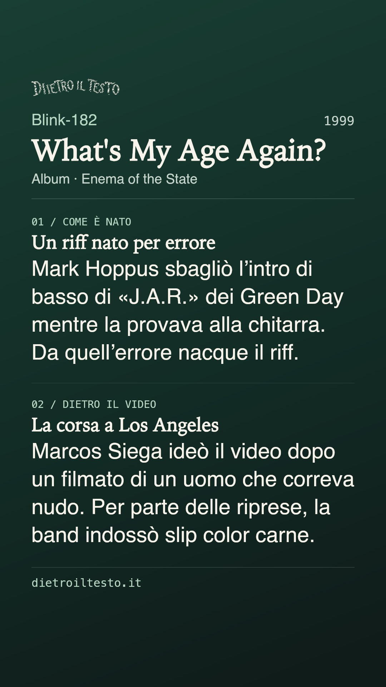
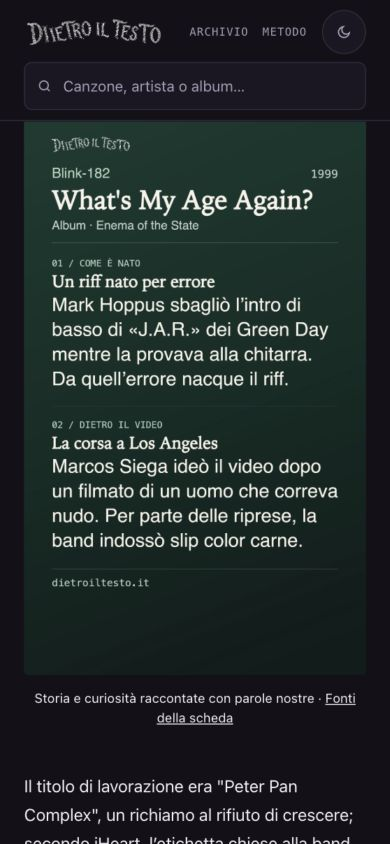

# What’s My Age Again? — anteprima rifinita, 15 ottobre 2026

## Richiesta e composizione

Ripreso il prototipo 6f5d86e4b su richiesta del proprietario: titolo proporzionato, informazioni utili, spazi curati e anteprima prima della pubblicazione. Durante il lavoro, dopo «molto meglio», richiesti ulteriore ottimizzazione dello spazio e assenza delle fonti nell’immagine. La nuova versione recepisce entrambi.

Titolo a 82 px su una riga (online 190 px su tre righe), logo originale ridotto a 246 px, artista/anno/album, due racconti completi di quattro righe. Corpo da 54 a 60 px nell’ultima revisione, interlinea 78 px; margine superiore ridotto e separatori distanziati dalle lettere. Eliminata la rubrica ridondante. Nessuna ellissi o riduzione automatica del corpo. Fonti escluse da raster e relativo alt; restano nei dati e nella pagina. Il sito è l’unica firma in fondo.

## Fonti riaperte il 15 ottobre

- [iHeart, 20 ottobre 2020](https://www.iheart.com/content/2020-10-20-mark-hoppus-says-whats-my-age-again-riff-was-inspired-by-green-day/): dichiarazioni di Hoppus al podcast di Chris DeMakes; errore nell’intro di basso di J.A.R. provata alla chitarra, origine del riff. Sintesi originale, nessun verso.
- [The Ringer, Alan Siegel, 31 luglio 2019](https://www.theringer.com/2019/07/31/music/blink-182-enema-of-the-state): intervista originale al regista Marcos Siega; filmato dello streaker e slip color carne durante parte delle riprese a Los Angeles.
- [Discografia ufficiale blink-182](https://www.blink182.com/pages/discography): Enema of the State del 1999 e canzone fra i singoli.

Nessuna nuova verifica integrale della scheda o dato di ascolti aggiunto. Grafica originale del sito con il logo esistente e testi originali: nessuna fotografia di terzi o immagine generata con AI.

## Identità e verifiche

Un JPEG 1080×1920 identico in figura, condivisione/scaricamento Storia e OG/Twitter; hash nell’URL. Post/Reel conservano il renderer precedente. Ritagli/cache delle piattaforme esterne restano fuori controllo del sito. Alt aggiornato al contenuto realmente disegnato. Collegamento Fonti della scheda subito sotto la figura.

Browser 1280×900, 390×844 e 320×568: una sola figura, file caricato e proporzioni corrette, URL coerenti, nessun overflow e zero errori/warning. Corpo raster circa 19 px a 390 e 15,1 px a 320. Screenshot osservati e viewport ripristinato. Contrasti AA, nessuna sovrapposizione, render ripetuto identico; titolo/testo troppo lunghi rifiutati senza troncarli. Cinque percorsi di condivisione/download/annullamento/caricamento/offline con stesso JPEG, senza invii reali ai social. SEO 696, coerenza/link 321/104 e affiliazioni 1065 positivi.

## Ambito e copia

Una sola pagina, un JPEG e sola voce whats-my-age-again di dati/pillole.json. Recuperate dal prototipo le validazioni del contenuto e il ramo del renderer dedicato; nuovo impianto in scripts/pillole/editoriale.cjs. Le altre dodici voci e JPEG sono identici. Ricerca.js, articolo fuori figura/URL versione, datePublished/dateModified, sei sitemap, collegamenti Amazon, 104 foto e altri HTML intatti. F40 riletta; nessun build generale o nuova data editoriale per questa modifica grafica.

Copia: /Users/gianmicheletroisi/.codex/worktrees/ritratto-nin-2026-10-15/dietro-il-testo. Ramo codex/cartolina-age-anteprima-2026-10-15 dalla base ee6da2d85. Prototipo 6f5d86e4b e documentazioni di pubblicazione Battisti 2ca2ae7ee / foto 8000133f1 su rami distinti preservati. Main/non tracciati e altra AI intatti. 308 cartoline ferme, nessun GSC o indicizzazione.

Solo anteprima e commit locale dopo le verifiche. Nessuna integrazione nel main, push o pubblicazione prima della valutazione del proprietario. Unire successivamente solo la voce distinta del JSON e la sezione ROADMAP dedicata.

