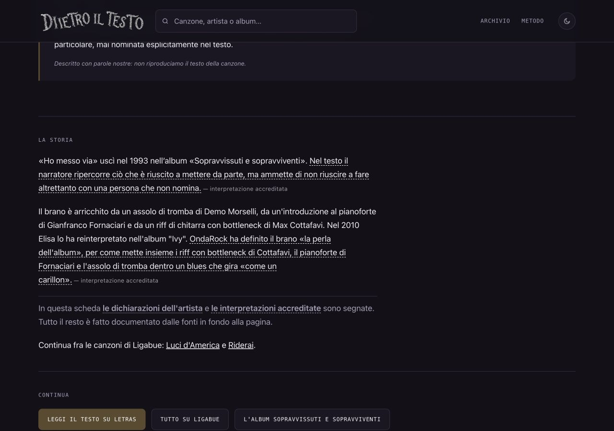

# Collegamenti contestuali Ligabue — 12 ottobre 2026

**Stato: approvato, integrato e pubblicato; produzione verificata il 12 ottobre 2026.**

## Problema e scelta del lotto

F60 è già concluso: le liste automatiche «Continua da qui» esistono. F70 conserva una vecchia riga «da fare», ma il registro dell’11 settembre ne documenta lo sblocco. Questo intervento è un seguito circoscritto del consolidamento F60/F70: usare evidenze storiche reali per aggiungere percorsi pertinenti fra schede esistenti, senza dichiarare risolto il problema dell’indicizzazione.

L’esportazione `Downloads/dietroiltestoind/dit-405-rilevate-2026-10-08.csv` coincide riga per riga con `Downloads/dietroiltesto-2/Tabella.csv` (405 righe). I metadati di quest’ultima specificano «Rilevata, ma attualmente non indicizzata». Contiene Luci d’America e Riderai; `1970-01-01` è il valore placeholder del campo scansione, non una scansione reale del 1970.

Nel file `Downloads/dietroiltesto.it-Performance-on-Search-2026-10-04-2.xlsx`, foglio Pagine, colonna D «Ultimi 28 giorni Impressioni», le tre sorgenti hanno:

| Sorgente | Impressioni storiche | Celle |
| --- | ---: | --- |
| Una vita da mediano | 144 | A26:D26 |
| Urlando contro il cielo | 119 | A29:D29 |
| Ho messo via | 37 | A52:D52 |

Il foglio Filtri, A3:B3, indica «Ultimi 28 giorni». La data del 4 ottobre è nel nome dell’esportazione: non si presenta il periodo come aggiornato al 12 ottobre. Le impressioni attestano esposizione storica nelle ricerche, non indicizzazione attuale. Nessun accesso a GSC e nessuna richiesta di scansione.

Verificate anche le cinque pagine HTTPS pubbliche prima della proposta: tutte identiche byte per byte al main locale. I sei percorsi mancavano realmente nelle tre sorgenti, comprese le liste automatiche. Le destinazioni avevano già altri link in entrata: non erano orfane.

## Modifica

Un breve paragrafo a fine «La storia» in ciascuna sorgente:

> Continua fra le canzoni di Ligabue: Luci d’America e Riderai.

I due titoli sono link normali verso le rispettive schede. Il criterio dichiarato è lo stesso artista, verificato nei dati; non si inventa un legame tematico o una fonte editoriale. Dati delle scelte separati dal modello, titoli letti da canzoni.json ed escapati; destinazioni assenti, duplicate, autoreferenziali o di altro artista bloccate. Nessun nuovo stile, prodotto o testo biografico.

| HTML modificato | Destinazioni aggiunte | Link |
| --- | --- | ---: |
| `canzone/una-vita-da-mediano/index.html` | `/canzone/luci-damerica/`, `/canzone/riderai/` | 2 |
| `canzone/urlando-contro-il-cielo/index.html` | `/canzone/luci-damerica/`, `/canzone/riderai/` | 2 |
| `canzone/ho-messo-via/index.html` | `/canzone/luci-damerica/`, `/canzone/riderai/` | 2 |

**Totale: tre HTML modificati, due destinazioni non modificate, sei nuove coppie sorgente/destinazione.**

## Prima e dopo

Misura sul grafo dei 696 HTML pubblici tracciati, contando una sola volta ogni sorgente per destinazione:

| Misura | Prima | Dopo |
| --- | ---: | ---: |
| Pagine che collegano Luci d’America | 10 | 13 |
| Pagine che collegano Riderai | 9 | 12 |
| Link interni nel DOM dell’intero sito | 22610 | 22616 |
| Collegamenti rimossi | — | 0 |

Rimuovendo soltanto i tre nuovi paragrafi, i 696 HTML coincidono byte per byte con la base. Date, dateModified, title, description, canonical, JSON-LD, testi, fonti, liste automatiche, link Amazon e disclosure preservati. Sitemap, canzoni.json, artisti.json, Costituzione e ricerca invariati. Nessuna generazione completa e nessun aggiramento della protezione lastmod.

## Prove

- `node scripts/check-collegamenti-contestuali.mjs`: tre percorsi e sei link, dati/destinazioni/posizione corretti.
- `node scripts/check-link.mjs`: 321 canzoni, 104 artisti, zero problemi.
- `node scripts/check-seo.mjs`: 696 pagine, zero problemi.
- `node scripts/check-affiliazioni.mjs`: 997 link, configurazione e informative corrette.
- `node scripts/check-coerenza.mjs`: 321 canzoni, 104 artisti, zero problemi.
- Tre render del modello in memoria conservano il nuovo paragrafo; l’helper è vuoto per le altre 318 canzoni. Nessuna riscrittura durante questa prova.
- Sintassi dei moduli e `git diff --check`: positivi.
- Browser a 1280 e 390 pixel: tutti e sei i percorsi provati fino alle due destinazioni e ritorno alla sorgente; nessun overflow.
- Tutte e tre le sorgenti anche a 320 pixel: due link per paragrafo, nessun overflow. Focus desktop visibile, titoli accessibili e link sottolineati.
- Su mobile il clic automatizzato al centro del rettangolo complessivo del link Luci d’America, spezzato su due righe, non attivava il link. Verificati Enter sui sei link e clic reale sul testo visibile di Luci d’America: positivo. Non si presenta il tentativo iniziale come una prova superata.

Anteprima costruita copiando le risorse pubbliche già tracciate in `sito/` e sostituendo solo i tre HTML. Server limitato a 127.0.0.1 e fermato dopo la verifica. HTTP pubblici controllati con curl e verifica TLS normale; Python di sistema non trovava la catena certificati locale, senza disabilitare la verifica.

[Prove e hash](prove-collegamenti-ligabue-2026-10-12.json)

## File del lotto

1. `dati/collegamenti-contestuali.json` — nuove scelte per le sole tre sorgenti.
2. `scripts/genera/collegamenti-contestuali.mjs` — validazione e paragrafo.
3. `scripts/genera/pagine.mjs` — inserimento del paragrafo nelle schede configurate, inerte nelle altre.
4. `scripts/check-collegamenti-contestuali.mjs` — controllo dei dati e dell’HTML.
5. `canzone/una-vita-da-mediano/index.html` — due link.
6. `canzone/urlando-contro-il-cielo/index.html` — due link.
7. `canzone/ho-messo-via/index.html` — due link.
8. `ROADMAP.md` — solo registro §93 del lavoro preparato/verificato.
9. `rapporti/collegamenti-ligabue-2026-10-12.md` — questo dossier.
10. `rapporti/prove-collegamenti-ligabue-2026-10-12.json` — misure, hash e browser.
11. `rapporti/prove-collegamenti-ligabue-2026-10-12/desktop.jpg`.
12. `rapporti/prove-collegamenti-ligabue-2026-10-12/mobile.jpg`.

## Copia, limiti e integrazione

Copia: `/Users/gianmicheletroisi/.codex/worktrees/collegamenti-ligabue-2026-10-12/dietro-il-testo`.
Ramo: `codex/collegamenti-ligabue-2026-10-12`. Base: `8512f7467cdde5f9fb92596387990743d7e5a008`.

Main e due documenti SEO non tracciati preservati. Copia dell’altra AI soltanto letta; risultano modificati due suoi rapporti, nessun file di questo lotto. Copie gestite rispondenti senza modifiche pertinenti; i controlli Git delle dodici vecchie copie in Documents/ChatGPT/Vediamo vanno in timeout: lasciate intatte. La nuova copia esiste correttamente; registrazione nell’app rifiutata per limite di 100 allegati, senza creare copie duplicate.

Dopo approvazione nominativa del proprietario, main e origin/main erano ancora sulla base 8512f7467: integrazione fast-forward dei soli dodici file, senza conflitti. Il JSON dei collegamenti contestuali non esisteva in main; aggiunte esclusivamente le tre chiavi autorizzate, senza sostituire dati di altri lotti. Nessuna modifica delle date o rigenerazione completa.

Il risultato misura raggiungibilità interna. Non promette scansione, indicizzazione o incremento del traffico e non aggiorna l’etichetta storica delle destinazioni in GSC. Filone concluso nella copia: collegamenti contestuali fra pagine esistenti.

## Pubblicazione verificata

- Commit dei contenuti approvati: `503adbad9c572ac1cc66aa4f319e64ec18d16649`, inviato a `origin/main`.
- Deployment: `dpl_AteBHttNRVBpj7huYZhGk1xNjxeZ`, **READY**, **production**, sorgente Git main e commit corrispondente, alias `www.dietroiltesto.it` assegnato senza errori.
- URL deployment: https://dietro-il-testo-39htjfof6-giantroisi1.vercel.app.
- Dashboard autenticata: stato Current/Ready, durata 12 secondi; log «Build Completed» e «Deployment completed». Avvisi sul runtime edge deprecato di middleware.js e conversione ESM/CommonJS: riguardano file invariati e non sono stati corretti ampliando il lotto.
- Dopo integrazione ripetuti tutti i sei controlli richiesti sulla copia allineata a main, con confronto byte per byte dei dodici file: contestuali, link, SEO, affiliazioni, coerenza e diff, tutti positivi.
- Confronto col main precedente su **702 HTML e sitemap**: cambiano soltanto i tre paragrafi di navigazione autorizzati. Date/datePublished/dateModified/lastmod, title, description e tutti i collegamenti affiliati preservati anche nelle pagine sorgente; ogni altro HTML e tutte le sitemap identici. Hash dei due documenti SEO non tracciati invariati.
- Sul dominio reale le **cinque pagine coinvolte e sei sitemap** sono identiche byte per byte a main, con HTTPS valido.
- Browser sul dominio reale a **1280 e 390 px**: cinque pagine uniche per larghezza; tutti i sei collegamenti provati e ritorno alle sorgenti, **12 percorsi completi** in totale, nessun overflow. Clic desktop ed Enter mobile, titoli delle destinazioni corretti.
- Console del browser: **zero errori** registrati durante i percorsi; nessun errore HTTP sulle undici risorse pubbliche controllate. La prova è circoscritta a questi percorsi, non un monitoraggio globale del traffico.
- Elenco deployment/eventi via connettore Vercel respinti 403; CLI assenti. Verifica completata tramite dashboard autenticata, log visibili e metadata MCP del singolo deployment: nessuna richiesta di nuovo login e nessun rilancio manuale.
- Roadmap, dossier, JSON delle prove e i due screenshot già elencati nel lotto aggiornati con il risultato online. Nessun nuovo file aggiunto al perimetro.
- **Nessuna richiesta GSC o IndexNow.**
