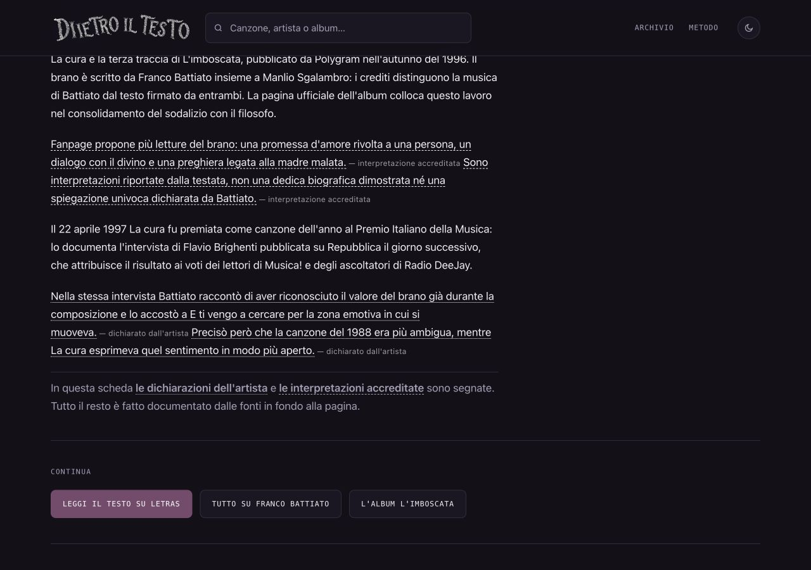
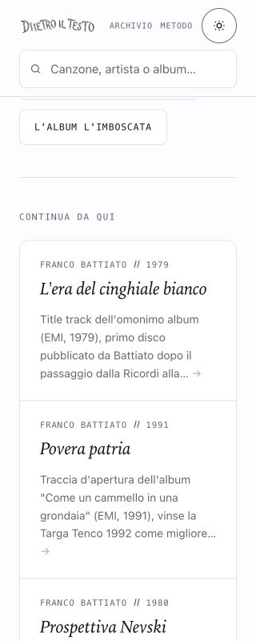
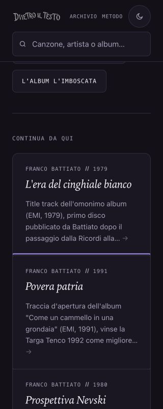
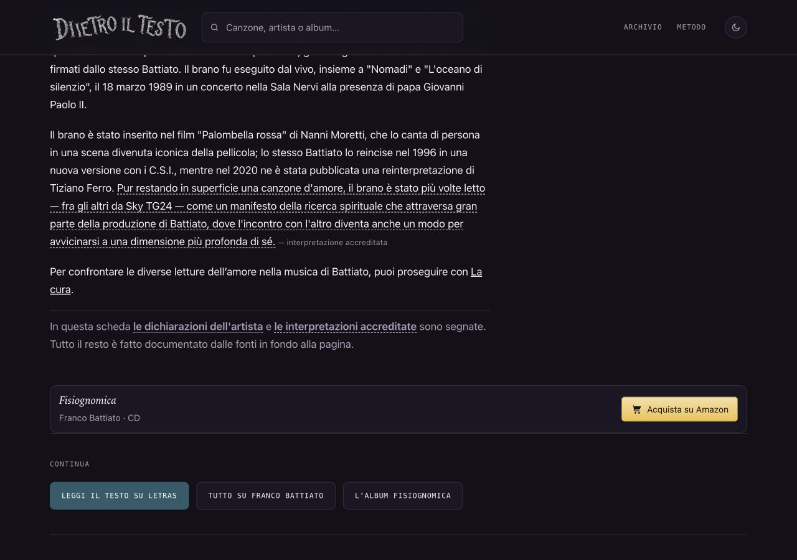

# La cura, Vengo dalla Luna e due collegamenti contestuali — 12 ottobre 2026

**Stato: approvato specificamente, integrato e pubblicato; produzione verificata il 12 ottobre 2026.**

## Problemi e intervento circoscritto

Le griglie di schede correlate usavano una larghezza minima di 300 px in un contenitore interno di 270 px su viewport 320. Il bordo destro e il testo venivano tagliati senza overflow del documento: misurare solo la pagina non mostrava il difetto. Il minimo ora è il minore fra 300 px e il 100% disponibile. A 320 px le colonne misurano 270 px, a 390 e 1280 mantengono rispettivamente 340 e 372 px, identiche al pubblico. Corrette le quattro pagine coinvolte; le altre pagine non sono state rigenerate e conservano il proprio stato. Il modello condiviso applicherà la correzione alle successive generazioni: non si dichiara risolto il difetto su tutto il sito.

La cura: testo ampliato con i soli fatti documentati, interpretazioni attribuite a Fanpage senza trasformarle in dedica o intenzione certa; momento iconico originale allineato. Il resoconto contemporaneo di Repubblica è del 23 aprile 1997 e dice che la premiazione avvenne il giorno precedente: **22 aprile**, non il 22 marzo riportato in una fonte secondaria. Il confronto con E ti vengo a cercare deriva dall'intervista di Battiato, non dalla lettura della redazione.

Vengo dalla Luna: sostituita la divergenza sulla partecipazione dei Måneskin con la documentazione diretta Sky dei Bootcamp 2017 e con la tracklist Chosen. Rimossi dal corpo il preciso 6 maggio 2004, l'ordinale di quarto singolo, la produzione della singola traccia e il dettaglio narrativo del video: non sostenuti dalle fonti riaperte per questo lotto. Questa rimozione non afferma che siano falsi. Lettura antirazzista attribuita a OndaRock e metafora dell'alieno a Matteo Furina, La Scimmia Pensa; momento iconico descritto senza parole della canzone.

Crediti originali e cover non concordano: Qobuz dell'originale indica Michele Salvemini, Qobuz della cover indica anche Diego Perrone; il sito ufficiale conferma Perrone come featuring. Il testo documenta la divergenza e non attribuisce definitivamente a Perrone la coautoria dell'originale.

## Mappa delle affermazioni e fonti riaperte

Controllo effettuato il **12 ottobre 2026**. Ogni riga riguarda il corpo e, dove indicato, il momento iconico. Nessuna fonte di lyrics è stata copiata.

| Pagina / affermazione | Fonte e limite |
|---|---|
| La cura §1: album, Polygram, 1996, terza traccia, contesto del sodalizio | [Discografia ufficiale, L'imboscata](https://www.battiato.it/limboscata/), letta nel browser. |
| La cura §1: compositore Battiato e testo con Sgalambro | [Apple Music, crediti della registrazione Torneremo ancora](https://music.apple.com/us/song/la-cura/1478113333), composizione e lyrics letti; fonte dichiarata del 2019, non confusa con una scheda del master originale. [Voce del singolo](https://it.wikipedia.org/wiki/La_cura_(singolo_Franco_Battiato)) come riscontro secondario dei crediti originali. |
| La cura §2 e momento iconico: letture amorosa, spirituale e madre malata | [Fanpage](https://music.fanpage.it/la-cura-di-franco-battiato-significato-storia-e-testo-della-canzone/), interpretazioni della testata. Non prova di una dedica biografica o di un'intenzione dichiarata dall'autore. |
| La cura §3: premio e votazione | [Intervista di Flavio Brighenti, Repubblica, 23 aprile 1997](https://ricerca.repubblica.it/repubblica/archivio/repubblica/1997/04/23/ho-ritrovato-il-gusto-per-il-rischio.html), fonte contemporanea letta nel browser. Data 22 aprile ricavata da «ieri» e dalla data di pubblicazione; nome del premio e voti Musica!/DeeJay dalla stessa fonte. |
| La cura §4: riconoscimento del valore durante la composizione e confronto con E ti | Stessa intervista, dichiarazioni dell'artista parafrasate e segnate D. Anno 1988 riscontrato anche nella [discografia ufficiale, Fisiognomica](https://www.battiato.it/fisiognomica/). |
| Vengo §1: sesta traccia, album del 2003 e featuring | [Caparezza, tracklist ufficiale Verità supposte](https://www.caparezza.com/v2017/releases/verita-supposte/). Secondo album riscontrato anche nella monografia OndaRock. |
| Vengo §1: crediti discordanti | [Qobuz originale](https://www.qobuz.com/it-it/album/verita-supposte-caparezza/0724359003955) e [Qobuz Chosen](https://www.qobuz.com/it-it/album/chosen-maneskin/o1t96aztw7rqp), campi autore/compositore letti e confrontati; nessuna scelta arbitraria fra originali e cover. |
| Vengo §2: lettura antirazzista | [OndaRock, Antonio Silvestri](https://www.ondarock.it/monografie/caparezza/), attribuzione editoriale I, non dichiarazione dell'artista. |
| Vengo §2 e momento iconico: narratore alieno e pregiudizi sull'origine | [La Scimmia Pensa, Matteo Furina, 28 giugno 2020](https://www.lascimmiapensa.com/2020/06/28/caparezza-vengo-dalla-luna-analisi-spiegazione-brano/), letta nel browser integrato dopo timeout Chrome; interpretazione I, non biografia. Non riprese le indicazioni cronologiche dell'articolo come prova dell'uscita originale. |
| Vengo §3: platino del brano originale, settimana 41/2019 | [FIMI, filtro CAPAREZZA e titolo](https://www.fimi.it/top-of-the-music/music/?artist=CAPAREZZA&title=VENGO+DALLA+LUNA), artista originale verificato, non confuso con la cover. |
| Vengo §3: cover ai Bootcamp X Factor 2017 | [Sky, video ufficiale Caparezza secondo i Maneskin](https://video.sky.it/xfactor/puntate/video/caparezza-secondo-i-maneskin-371069) e [Sky TG24, EP Måneskin, 19 dicembre 2017](https://tg24.sky.it/spettacolo/musica/2017/12/19/x-factor-2017-ep-maneskin): la descrizione diretta del programma conferma la fase; non ipotizzata dalla frase generica di Rockol. |
| Vengo §3: presenza della cover nell'EP Chosen | [Rockol, tracklist Chosen](https://www.rockol.it/recensioni-musicali/album/7642/maneskin-chosen), terza traccia. |
| Fuori: stesso album e narratore di Vengo | Tracklist ufficiale Caparezza e interpretazione esplicitata nel paragrafo Vengo, non nuova affermazione sull'intenzione dell'autore. |
| E ti: confronto fra letture dell'amore | Invito alla lettura della nuova scheda; non affermazione biografica o incremento stimato SEO. |

Spotify: conservati i player verificati dei brani, La cura `3sc9YIcDSPCXsQ0zzX3JLW` e Vengo `424BQDJzOJqfJCZusTvAZP`. Rimandi Letras riaperti e titolo/artista confrontati: La Cura — Franco Battiato, redirect a 1103935; Vengo Dalla Luna — Caparezza, 413836. Verificata la destinazione, senza importare testo né traduzioni.

## Due nuovi collegamenti, nelle posizioni richieste

- E ti vengo a cercare, dopo il secondo paragrafo della storia e prima della legenda: «Per confrontare le diverse letture dell’amore nella musica di Battiato, puoi proseguire con La cura.» Solo il titolo è collegato.
- Fuori dal tunnel, dopo il primo paragrafo: «Nello stesso album compare anche Vengo dalla Luna, dove il narratore alieno porta il discorso sui pregiudizi verso chi viene da un altro luogo.» Solo il titolo è collegato.

Erano già presenti schede che collegavano le destinazioni: aggiunte due ancore contestuali, non due nuove pagine sorgente distinte. I tre percorsi Ligabue e i sei link precedenti restano identici. Nessuna indicizzazione Google attuale dedotta dallo storico e nessun nuovo accesso GSC o richiesta IndexNow.

## Perimetro, date e generazione

- Quattro HTML: La cura, Vengo dalla Luna, E ti vengo a cercare e Fuori dal tunnel. **Ogni altro HTML e tutte le sitemap coincidono con la base.**
- Modificati solo due oggetti del catalogo canzoni su 321; ordine e altre 319 voci invariati. Aggiunte solo due chiavi al JSON dei collegamenti contestuali.
- Title, description, og:description, canonical e datePublished confrontati con HEAD e preservati nelle quattro pagine. DateModified aggiornate al 12 ottobre soltanto nei quattro HTML sostanzialmente modificati. Lastmod sitemap lasciati identici per il perimetro richiesto.
- **Limite noto:** la description preesistente di Vengo conserva la coautoria presentata senza la qualificazione del nuovo corpo. Il mandato congela le description: occorre un intervento autorizzato sui metadati per allinearla. Non si dichiara la scheda interamente certificata.
- I numeri ascolti legacy e i loro rimandi generici Kworb non modificati né certificati dal lotto; non sono fatti del nuovo corpo pubblicato. Revisioni editoriali datate nelle due schede, senza aggiungere `ultimaVerifica` o inventare una verifica indipendente.
- Due OG rigenerate con lo script del progetto, viste a 1200×630: titolo, artista, anno, testo originale attribuito; nessun verso riprodotto. Copiate anche nell'anteprima e versionate nel registro OG. Non modificati gli OG delle altre schede.
- Nuovo `--solo-canzoni` nel generatore: scrive i soli slug selezionati senza cancellare altre pagine, senza sitemap né manifest. Tre input negativi (vuoto, inesistente, duplicato) respinti prima di scrivere; ogni file dell'anteprima confrontato prima e dopo, identico. Per l'anteprima, gli OG vanno copiati separatamente nel sottoinsieme `sito/og` dopo la loro generazione.
- Modelli condivisi: CSS minimo adattabile, possibilità di posizionare una sola ancora contestuale fra paragrafi, stato di revisione editoriale opt-in. Le vecchie schede senza i nuovi campi mantengono il comportamento precedente.

## Prove e controlli

SEO: **696 HTML, zero problemi**; link interni, coerenza, nature e diff positivi. Affiliazioni: **1.065 link**, tutti verificati, catalogo commerciale e URL invariati. Contestuali: **5 percorsi, 8 link**, comprese le tre sorgenti Ligabue. Tre prove negative del generatore positive.

Due controlli globali non passano già sulla base: `check-bollino` segnala gli stessi **24** bollini senza verifica indipendente; `check-garanti` passa da **49 a 48** occorrenze non registrate, con **zero chiavi nuove** e rimozione della vecchia attribuzione Wikipedia sulla cover. Il rilevatore non rileva ogni forma di attribuzione: la mappa manuale sopra è parte della verifica, non il solo conteggio automatico. Nessun bollino assegnato alle due revisioni.

Browser: quattro pagine × **1280, 390 e 320 px**, dodici casi. H1 unico, nessuna immagine locale rotta, documento e griglie senza overflow o schede tagliate. Due link seguiti da tastiera su mobile e desktop con destinazione e ritorno alla sorgente: **quattro percorsi completi**. Console del browser integrato: **zero errori** registrati. Confronto pubblico La cura: 390/1280 identici nelle misure delle colonne; 320 passa da 300 a 270 px nella copia. Controllo visivo tema scuro e chiaro mobile e storia desktop positivo. Chrome è diventato indisponibile: prove finali e fonti residue completate nel browser integrato, senza chiedere un nuovo login.

Log conservati con spazi finali e righe finali vuote normalizzati, senza cambiare il contenuto dei risultati. Prove strutturate e log: `rapporti/prove-cura-luna-mobile-2026-10-12.json` e cartella omonima.

## Copia e approvazione

Copia: `/Users/gianmicheletroisi/.codex/worktrees/cura-luna-mobile-2026-10-12/dietro-il-testo`.
Ramo: `codex/cura-luna-mobile-2026-10-12`.
Base: `984d94f61418df667d5fba1eb84cf7125ac06e9b`.

Registrazione dell'allegato app fallita per limite di 100 identità; il checkout Git esiste ed è stato usato senza duplicarlo. Main, i due documenti SEO non tracciati, copia dell'altra AI e proposte precedenti preservati. Routine sospesa.

La richiesta iniziale arriva dalla chat di coordinamento. Dopo presentazione del lotto 6ddf6ec27 e dei limiti, il proprietario ha risposto direttamente alla domanda nominativa: **«Approvo questo lotto con i limiti dichiarati»**, autorizzando integrazione, push e pubblicazione. Il precedente «approvo» Amazon non è stato usato per questo nuovo lotto.

Main/origin erano ancora sulla base 984d94f61: eseguito fast-forward del solo commit approvato 6ddf6ec27, senza conflitti né sovrascrittura di altri lotti. Tutti i 29 file confrontati con la copia. Nessuna rigenerazione completa; quattro HTML e due OG pubblicati con modelli e documentazione.

## Pubblicazione verificata

- Commit contenuti: `6ddf6ec272df46f25845415a45956762d3032a4b`, inviato a `origin/main` dopo approvazione nominativa.
- Deployment: `dpl_Aa1K3KvWLaXtRB2ZfPMGQVgzsfUN`, **READY**, **production**, progetto `prj_wpklj5eOzmkjNB97wQMvoaTV2Uvm`, sorgente Git main e SHA esatto. Alias `www.dietroiltesto.it` presente, nessun aliasError. Build 17 secondi.
- URL: https://dietro-il-testo-m2l7yjjx1-giantroisi1.vercel.app.
- **Quattro pagine, sei sitemap e due OG HTTPS** identici byte per byte a main. Gli HTML non compresi nel lotto e le sitemap sono rimasti identici alla base; title, description, canonical e datePublished delle quattro pagine invariati. DateModified al 12 ottobre soltanto per le quattro pagine coinvolte.
- Browser live: quattro pagine a **1280, 390 e 320 px**, **12 casi positivi**, griglie 372/340/270 px, nessuna scheda tagliata, H1 unico, nessuna immagine locale rotta o overflow.
- Due link seguiti su desktop e mobile, **quattro percorsi completi** e ritorno alle sorgenti. Desktop con clic, mobile da tastiera. Il clic automatico al centro del bounding box di «La cura», disposto su due righe, cadeva fra i due frammenti: clic sulla parola effettiva positivo; è un limite del clic automatico, non un collegamento interrotto.
- Console: zero errori nel percorso verificato. Non è una scansione globale dei log del sito.
- Ripetuti SEO, link, affiliazioni, contestuali, coerenza, nature e diff. Il primo check contestuali in main leggeva `sito/` ignorato, una vecchia anteprima: non è stata modificata. I **29 file tracciati** coincidono con la copia allineata, sulla cui anteprima corrispondente i controlli sono positivi; il pubblico coincide con gli HTML tracciati.
- Metadata del deployment disponibili. Lettura progetto ed eventi/build log via connettore Vercel respinta 403; CLI non disponibile. Verifica completata con stato, SHA, progetto, alias e risposta HTTPS effettiva. Log globali non consultati; nessun rilancio o modifica alle protezioni.
- GitHub combined status restituisce zero check; non è stato interpretato come prova di build riuscita. La prova del rilascio è il metadata Vercel READY e il confronto pubblico.
- Limiti editoriali approvati invariati: description Vengo non qualificata sui crediti, disaccordo dichiarato nel corpo, nessun bollino indipendente nuovo; vecchi gates globali documentati sopra.
- Routine **PAUSED**, file SEO non tracciati e altra AI preservati. **Nessuna richiesta GSC o IndexNow.**

