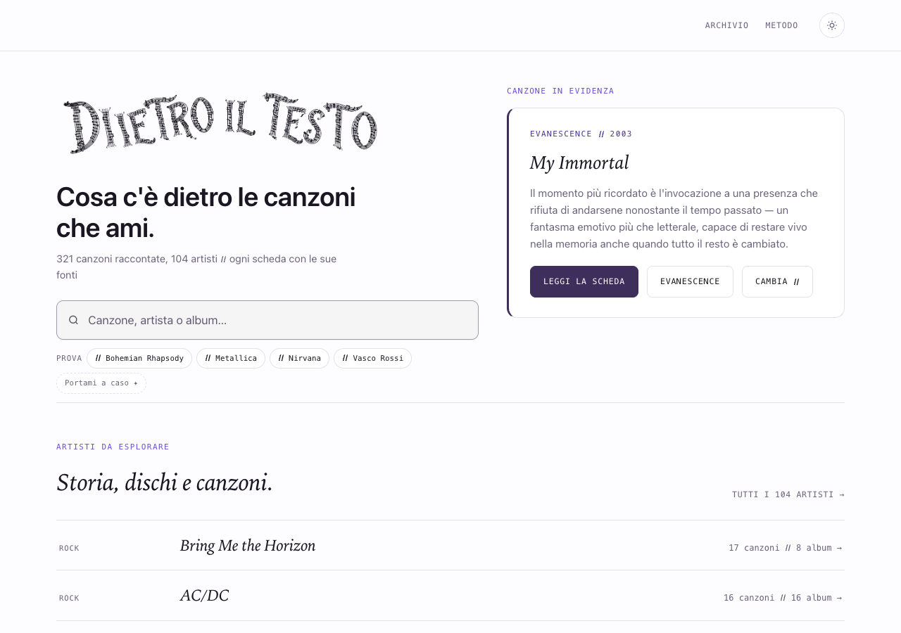
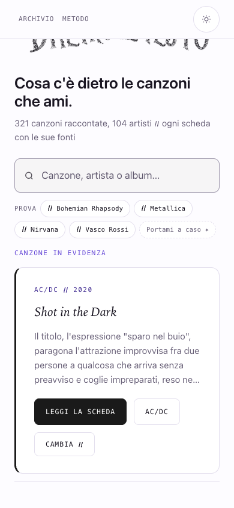

# Generatore: perimetro esatto e date stabili — 20 ottobre 2026

## Stato

**Preparato e verificato nella sola copia separata. Non integrato, non pubblicato.**

Copia: `/Users/gianmicheletroisi/.codex/worktrees/generatore-perimetro-2026-10-20/dietro-il-testo`. Base pubblicata ad9091a51; dipendenze locali concorrenti e diagnosi conservate separatamente in 8eda33649. Nessuna modifica nella cartella principale, nei suoi file non tracciati o nelle altre copie. Collegamento della copia alla chat non riuscito per il limite di 100 allegati dell’app: cartella e commit locali esistono regolarmente.

Mandato: cinque correzioni documentate nella diagnosi353, controllo aggiuntivo sugli URL esatti, cartoline/link futuri circoscritti, home indipendente dalla data del build, prove positive/negative e nessuna pubblicazione.

## Diff e file

| File | Intervento |
|---|---|
| scripts/genera/pagine.mjs | una interpolazione cartolina e quattro componenti opzionali artista senza newline a vuoto; scelta iniziale home letta da configurazione stabile |
| scripts/genera/ricerca.mjs | rotazione client conserva pool e pulsante; identifica la canzone iniziale dall’HTML, senza Date.now |
| scripts/genera-sito.mjs | controllo perimetro prima di chiusura; valido anche in rendering mirato; limite quantitativo senza deroga numerica; conservazione artefatti invariati |
| scripts/genera/perimetro.mjs | confronto più stretto di F40 che include anche estratti correlati; lista URL esatta; controllo globale delle sole voci/immagini cartolina dichiarate |
| dati/evidenza-home.json | My Immortal, identica selezione iniziale già pubblicata; non sceglie un nuovo contenuto |
| dati/baseline-generatore.json | sigillo tecnico delle cartoline/immagini attuali e compatibilità chiusa degli scarti storici, mai aggiornata automaticamente |
| scripts/test-generatore-perimetro.mjs | suite offline con fixture in cartella temporanea, eliminata anche in caso di errore |
| ROADMAP e rapporto/prove | solo stato, ambito, verifiche e limiti |

`scripts/indexnow.mjs` è identico alla versione concorrente presente nel main all’inizio: nessuna nuova modifica. Il suo controllo resta attivo; le sole dipendenze sono nel commit base, distinto dalla correzione. Non selezionare per errore un diff rispetto al vecchio ad9091a51 che nasconderebbe questa distinzione.

## Perché la compatibilità puntuale

Il modello corretto produce zero delle353 false variazioni. Il confronto ha rilevato anche una differenza inversa di sola formattazione sulla pagina R.E.M., già generata con quattro righe vuote nella versione pubblicata. Non viene riscritta soltanto per uniformare gli spazi.

La diagnosi aveva inoltre censito33pagine con36vecchi estratti correlati. Per non propagarli, il sigillo contiene34coppie di impronte (33estratti più R.E.M.): **solo quando entrambe le impronte pubblicata/generata coincidono esattamente con quelle censite si conserva il vecchio file, byte per byte**. Non si ignorano nuovi scarti, non si amplia una whitelist in base agli errori, non si autorizzano cambiamenti su questi URL. Qualsiasi nuova differenza rompe la coppia e viene sottoposta al perimetro esatto.

Per tutte le altre pagine, quando il contenuto dopo le esclusioni tecniche è identico, viene conservato l’HTML pubblicato: niente diffusione involontaria di CSS, formattazione, revisioni o componenti condivisi durante un lotto locale. Il nuovo confronto di perimetro mantiene gli estratti correlati nel controllo, mentre F40 conserva il proprio criterio sulle date editoriali.

## Manifesto di un futuro lotto

La dichiarazione precede il lavoro e non equivale all’approvazione di pubblicazione. Nessun manifesto significa **zero pagine e zero cartoline attese**. La lista deve coincidere con le pagine realmente modificate: anche URL dichiarati in eccesso bloccano.

Esempio di sola struttura, non di lotto autorizzato:

```json
{
  "versione": 1,
  "pagine": ["/canzone/slug-esistente/"],
  "cartoline": []
}
```

Per una cartolina si aggiunge una voce che identifica esattamente slug, `dati/pillole.json#slug` e `pillole/slug-storia.jpg`. Una seconda voce del registro o un’altra immagine modificata causano un errore, anche nel rendering mirato. Lo script non genera immagini, non inventa contenuti e non approva nuovi prodotti.

Il manifesto si passa con `--lotto <file.json>`. Il limite resta min(50,10% del catalogo), oggi50, anche per una lista esatta di51URL. La deroga `--impatto-atteso` non è più ammessa: nessun aggiramento numerico. Una modifica su un URL non atteso interrompe il processo prima delle sitemap; un output incompleto non è un risultato pubblicabile.

Il sigillo della base non viene rigenerato dalle routine. Dopo un futuro lotto approvato e verificato, l’eventuale avanzamento delle impronte deve essere esplicito e revisionato, non ricavato automaticamente dagli errori. Le modifiche tecniche condivise a CSS o footer richiedono un piano distinto: questo lotto non ne autorizza la propagazione.

## Prove obbligatorie

| Caso | Esito |
|---|---|
| Due generazioni complete, orologi20/10/2026 e01/01/2030 | 1124file byte-identici;696HTML uguali alla base; sei sitemap byte-identiche |
| Nessun intervento editoriale | datePublished0, dateModified0, lastmod0, canonical0, URL sitemap0; inventario571URL |
| Cartolina dichiarata | cambia soltanto la canzone fixture21Guns, una voce dati e una JPEG dichiarata; un solo dateModified/lastmod |
| Cartolina non dichiarata / altra immagine / altra voce dati | tutti bloccati; immagine estranea rilevata anche nel rendering mirato |
| Collegamento interno dichiarato | soltanto la sorgente21Guns cambia; destinazione e altre pagine intatte; unico dateModified/lastmod della sorgente |
| Link senza manifesto / seconda sorgente non dichiarata | bloccati |
| Youngblood: modifica reale del primo paragrafo con effetto su estratti correlati | bloccato sull’URL derivato non dichiarato; non mascherato dalla compatibilità storica |
| URL dichiarato ma non cambiato | bloccato |
| 51modifiche reali con lista esatta | bloccate dal limite50 |
| Richiesta di deroga numerica | rifiutata |
| Guardie IndexNow --tutti e51URL | verificate isolando i soli frammenti puri in VM; nessuna esecuzione dello script, lettura chiave, rete o invio |

14casi passati. Le fixture riusano temporaneamente bytes di una JPEG esistente per provare il controllo: **non sono nuove cartoline, non sono state valutate editorialmente né pubblicate**. Gli output delle fixture sono rimossi nel finally. Date simulate consentono di verificare davvero un cambio di giorno/anno e non due esecuzioni nello stesso minuto.

Controlli sul rendering stabile: SEO696/zero problemi; coerenza321canzoni/104artisti/zero problemi; sette percorsi contestuali e dieci collegamenti validi; affiliazioni1065link validi e invariati. Tutto eseguito nelle copie temporanee. Sintassi e diff senza errori.

## Home: risultato visibile

L’HTML della homepage resta byte-identico alla versione pubblicata, con **My Immortal — Evanescence** iniziale. Il pool dei candidati della rotazione continua a derivare dalle stesse canzoni già presenti; non è stato cambiato il criterio editoriale. Il client usa casualità al caricamento e al pulsante, senza leggere la data, mentre l’HTML resta stabile.

Browser in profilo temporaneo Chrome, nessuna sessione personale:1280×900 e390×844; al clic il link passa da CanYouFeelMyHeart a ShotInTheDark con seme di prova controllato; nessun overflow, errore JS o console. Con JS disabilitato compareMyImmortal. Richieste esterne bloccate/neutralizzate nel test: non è una verifica dei servizi o font remoti.





## Impatto esatto e passo successivo

- Artefatti pubblici toccati nella cartella principale: **zero**.
- HTML, immagini, sitemap, date, canonical e URL da pubblicare per questa preparazione: **zero**. Non preparati nuovi contenuti.
- La futura integrazione riguarda i sorgenti e le protezioni tecniche. L’aggiornamento del solo client `ricerca.js`, generato e verificato nelle prove, deve essere incluso esplicitamente nell’eventuale autorizzazione di rilascio; nessuna necessità di rigenerare gli HTML pubblici.
- Nessuna modifica ad Amazon, dati editoriali, ritratti, cartoline, IndexNow o GSC. Nessun push/deploy/integrazione.
- Prove in `rapporti/prove-generatore-perimetro-2026-10-20/`, inclusi confronto dei702artefatti HTML+sitemap, log,14casi, browser, schermate e client di anteprima. Nessun asset di test da pubblicare.

**Da approvare:** integrazione del lotto tecnico e, separatamente dal semplice stato di preparazione, eventuale push/pubblicazione del client verificato. Il gate non dà questa autorizzazione. Fino ad allora le routine non avviano altri lotti sopra questa preparazione.
