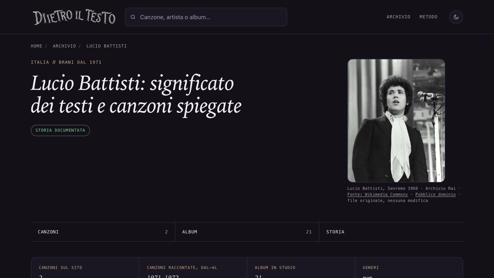
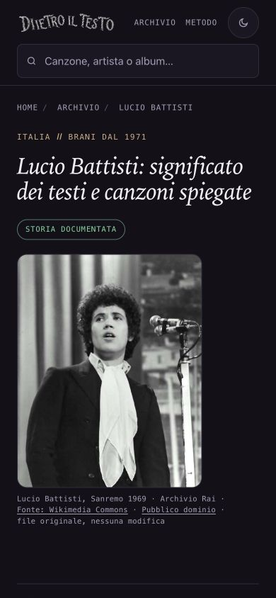

# Lucio Battisti — Sanremo 1969, 15 ottobre 2026

## Osservazione e scelta

Il proprietario ha riaperto la ricerca di Battisti chiedendo un’altra foto, ha visto il JPEG nella conversazione e ha autorizzato «procedi». La sospensione precedente è superata per questa preparazione. La fotografia in bianco e nero mostra il solo Battisti, volto leggibile, giacca scura e foulard chiaro, al microfono sul palco di Sanremo nel 1969. File originale e anteprima nella fonte osservati; nessuna ricostruzione o alterazione.

## Fonte e stato dei diritti

Titolo: Sanremo 1969 Lucio Battisti.jpg. La [pagina originale Commons](https://commons.wikimedia.org/wiki/File:Sanremo_1969_Lucio_Battisti.jpg), riaperta il 15 ottobre 2026, dichiara fonte Archivio Rai - Radiotelevisione Italiana, autore Rai, data 1 febbraio 1969, pubblico dominio PD-Italy e PD-1996. È stata riaperta anche la [spiegazione PD-Italy](https://commons.wikimedia.org/wiki/Template:PD-Italy): distinzione fra fotografia semplice e opera fotografica, con relative condizioni territoriali. Nessuna licenza Creative Commons viene attribuita al JPEG e nessuna licenza del testo della pagina viene confusa con i diritti sulla foto. Il riuso anche commerciale e le modifiche derivano dallo stato di pubblico dominio dichiarato per il file; nessuna modifica è qui applicata.

La [pagina ufficiale Rai Teche](https://www.teche.rai.it/2019/01/sanremo-69-serata-parte-ii/) conferma l’apparizione al festival con Un’avventura. È un riscontro del contesto, non una concessione di licenza autonoma sul JPEG. Limite dichiarato: la scheda Commons non identifica il fotografo individuale né un numero d’inventario Rai; l’attribuzione archivistica è quella della scheda, senza inventare un autore individuale. Il credito usa soltanto l’anno.

[URL del file originale](https://upload.wikimedia.org/wikipedia/commons/d/d3/Sanremo_1969_Lucio_Battisti.jpg): JPEG 472×597, 28700 byte, SHA256 6c290f8c98154a11a922f6f312c67a68ea55c291fa387891c997564549c965f1. File conservato identico senza conversione, ridimensionamento, ritaglio o ritocco. Attribuzione non obbligatoria per copyright secondo lo stato dichiarato, ma autore/fonte/stato visibili per trasparenza. Nessun sostegno della Rai o dell’artista implicito.

## Uso

Pagina: /artista/lucio-battisti/. Asset: ritratti/lucio-battisti-sanremo-1969.jpg. Identico JPEG nella figura, og:image e twitter:image; le piattaforme social possono applicare propri ritagli/cache. Questa pagina artista condivide il link, non genera le cartoline Instagram/Storia delle canzoni.

Credito visibile: Lucio Battisti, Sanremo 1969 · Archivio Rai · Fonte: Wikimedia Commons · Pubblico dominio · file originale, nessuna modifica.

Alt: Lucio Battisti sul palco di Sanremo nel 1969, in giacca scura e foulard chiaro davanti ai microfoni. Fotografia in bianco e nero.

## Ambito e verifiche

Sola chiave lucio-battisti nel registro, un JPEG, un HTML artista e sola relativa voce sitemap-artisti.xml; documentazione e ROADMAP §118. DateModified/lastmod 15 ottobre 2026 solo per questa pagina, datePublished preservata. Altri HTML/sitemap, 103 voci precedenti e asset, biografia, canzoni, discografia e collegamenti commerciali identici alla base. F40 riletta prima del rendering; nessun build generale o rigenerazione di massa. Figura prodotta dal componente corrente; applicata alla sola pagina la griglia mobile corrente del template.

SEO 696 pagine, coerenza/link 321 canzoni e 104 artisti, affiliazioni 1065, crediti/hash/casi negativi: tutti positivi. Browser 1280×900, 390×844 e 320×568: immagine caricata, alt e credito presenti, OG/Twitter stesso JPEG, nessun overflow orizzontale, nessun ingrandimento e zero errori/warning console. Foto resa circa 253×320 su desktop e 261×330 su mobile. Screenshot desktop e mobile osservati; viewport ripristinato. Nessuna nuova verifica integrale della biografia.

## Copia e autorizzazioni

Copia riusata pulita: /Users/gianmicheletroisi/.codex/worktrees/ritratto-nin-2026-10-15/dietro-il-testo. Ramo codex/ritratto-battisti-2026-10-15 dalla base 600ffc4bb77b2ad70d794dfb95802d82aa63ccb8. Prove locali della pubblicazione delle 41 foto conservate sul ramo codex/foto-pendenti-prove-pubblicazione-2026-10-15 (8000133f1), non trasferite. Main, file non tracciati, copia dell’altra AI e proposte in revisione preservati. 308 cartoline ferme. Nessun dato GSC o nuovo Amazon.

Preparazione e commit locale autorizzati da «procedi», dopo la foto mostrata. Integrazione nel main, push e pubblicazione di questo nuovo lotto restano soggetti alla specifica approvazione prevista dalla routine. Per integrare, aggiungere solo la chiave lucio-battisti al JSON e la sezione §118 a ROADMAP senza sovrascrivere voci o sezioni distinte.

