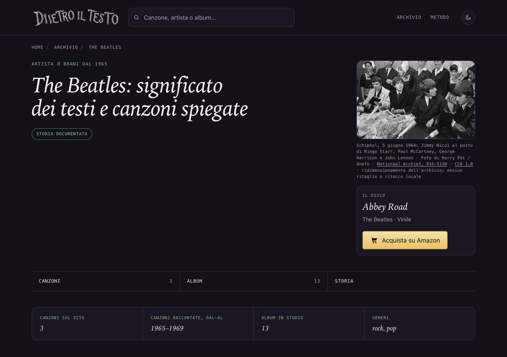

# The Beatles — Schiphol 1964, 15 ottobre 2026

## Osservazione e scelta

La pagina artista è senza fotografia. Ripresa la ricerca del 14 ottobre, quando il sito del titolare era in manutenzione: il 15 ottobre la pagina originale è tornata accessibile, con metadati e download verificabili. Nessuna prova precedente del motore di ricerca è stata usata come autorizzazione finale. Non ci sono proposte fotografiche Beatles pendenti nei rami individuati; i lotti di altri artisti restano intatti.

Fotografia osservata nell’originale3648×2406 e nell’asset1516×1000: quattro musicisti seduti davanti a fiori e microfoni, con persone in abito tradizionale alle spalle. Da sinistra, come precisa la fonte: Jimmy Nicol, Paul McCartney, George Harrison e John Lennon. Jimmy Nicol sostituisce Ringo Starr, assente dalla foto. Contesto: conferenza stampa all’arrivo a Schiphol, 5 giugno 1964. Graffi e segni del negativo conservati; nessun restauro o ricostruzione.

## Provenienza e licenza

Autore: Harry Pot / Anefo. Titolare dichiarato: Nationaal Archief. Titolo originale: Aankomst Beatles op Schiphol, de Beatles tijdens persconferentie. Vlnr Jimmy Nicol, vervanger van Ringo Starr, Paul McCartney, George Harrison, John Lennon. Collezione Anefo, accesso2.24.01.05, inventario916-5130. [Pagina originale del titolare](https://www.nationaalarchief.nl/onderzoeken/fotocollectie/aa6c0234-d0b4-102d-bcf8-003048976d84) riaperta e registrata con schermate e metadati. Campo Auteursrechthebbende: Nationaal Archief, CC0. Sezione Download: riuso libero e gratuito esplicito.

[Politica del titolare](https://www.nationaalarchief.nl/research/gebruik-van-scans-van-fotos-kaarten-en-documenten) e [CC0 1.0 Universal](https://creativecommons.org/publicdomain/zero/1.0/) riaperte il15ottobre2026: uso commerciale e modifiche consentiti. Il titolare applica la rinuncia alle immagini scaricabili marcate CC0/pubblico dominio; entrambi i requisiti sono presenti su questo asset. Attribuzione non obbligatoria secondo CC0 e la politica del titolare, ma autore/fonte/licenza/modifiche visibili per trasparenza. Nessun sostegno implicito; eventuali diritti della personalità e marchi non sono modificati da CC0.

[Scansione a risoluzione originale](https://service.archief.nl/gaf/api/file/v1/render/962c10f0-508c-4c51-9f45-9722c58475d7): JPEG3648×2406,985577byte, SHA2560272dfc291626b0f7f4733c22d084ca4b731e522e895e5d3e6d6f634bfbe85c1. [Asset ridotto del titolare adottato](https://service.archief.nl/gaf/api/file/v1/img/962c10f0-508c-4c51-9f45-9722c58475d7?h=1000): JPEG1516×1000,219226byte, SHA2562f5e27ac68288274978562e7d58bd0940607e5a94448d556fdbac9c60f0bb83a. Entrambi scaricati due volte identici e osservati. Le etichette di download mostrano gli assi in ordine invertito: si registrano le dimensioni effettive dei JPEG. Ridimensionamento proporzionale effettuato dall’archivio; nessun ritaglio, ritocco o conversione locale. Nessun ingrandimento CSS.

## Uso e accessibilità

Pagina: /artista/the-beatles/. Asset: ritratti/the-beatles-schiphol-1964.jpg. Stesso identico JPEG in figura, og:image e twitter:image. La pagina artista condivide il link; non ha il generatore Instagram/Storia delle canzoni. Cache e ritagli delle piattaforme social restano esterni al sito.

Credito visibile: Schiphol, 5 giugno 1964: Jimmy Nicol al posto di Ringo Starr, Paul McCartney, George Harrison e John Lennon · Foto di Harry Pot / Anefo · Nationaal Archief, 916-5130 · CC0 1.0 · ridimensionamento dell’archivio; nessun ritaglio o ritocco locale.

Alt: Jimmy Nicol, Paul McCartney, George Harrison e John Lennon seduti davanti ai microfoni a Schiphol nel 1964; Ringo Starr non è raffigurato. Fotografia in bianco e nero.

## File, date e verifiche

Nuovo asset e sola chiave the-beatles in dati/ritratti.json; unico HTML artista/the-beatles/index.html e sola voce sitemap-artisti.xml. Dossier/prove e ROADMAP§115. Unico dateModified/lastmod11→15ottobre2026. datePublished, titolo, description, H1, canonical, editoriale, fonti e CTA preservati. Altri697HTML tracciati,60ritratti precedenti e cinque sitemap identici alla base6f675aa65. Nessun dato computato, generatore, ricerca, Amazon o cartolina modificato. Sola griglia mobile già corrente nel template sulla singola pagina.

F40 letta e protezioni controllate prima del rendering mirato; nessun build generale. Renderer temporaneo rimosso. Confronto esatto con la pagina prevista: sole foto/metadati foto/data/griglia mobile. SEO696, coerenza/link321canzoni-104artisti,1065affiliazioni e crediti/hash/dimensioni/casi negativi: positivi. Applicata la skill Vercel verification al percorso registro→HTML→file→credito→OG/Twitter, senza API o variabili d’ambiente per questo sito statico.

Browser1280×900,390×844 e320×568 scuro;320anche chiaro: nessun overflow orizzontale o ingrandimento, immagine caricata e credito leggibile. Foto circa300×199desktop e280×185mobile. Screenshotdesktop/mobile osservati. Zero errori o warning locali; linkCC0 aperto da tastiera e ritorno verificati, tema e viewport ripristinati. Nessuna nuova verifica integrale della biografia.

## Copia e autorizzazioni

Copia riusata: /Users/gianmicheletroisi/.codex/worktrees/youngblood-crediti-2026-10-13/dietro-il-testo. Il vecchio lottoYoungblood4dca93460 è già antenato del main pubblicato; il suo ramo è conservato. Nuovo ramo codex/ritratto-beatles-2026-10-15 dalla base6f675aa65de55bba1e25d0f583bf53c7fe0bf4ee. Le copie Rino/Mina non più presenti non sono state ricreate. Prove della pubblicazioneNirvana86a877f4f conservate sul ramo distinto. Audit29copie,12timeout e voce remota assente preservati; altraAI e rapporti16–46 intatti. Finley/DeAndré/prototipo restano in revisione e308cartoline ferme. Main e due non tracciati preservati.

Preparazione consentita dalla routine e dalla richiesta umana «riprendi». Commit solo locale dopo i controlli. Integrazione nel main, push e pubblicazione richiedono approvazione specifica successiva. Unire soltanto la chiave the-beatles e§115 senza sostituire altre voci del JSON o sezioni di ROADMAP. Nessun GSC, indicizzazione o nuovo Amazon. Limite: manca Ringo, è presente il suo sostitutoJimmyNicol, dichiarato chiaramente.
