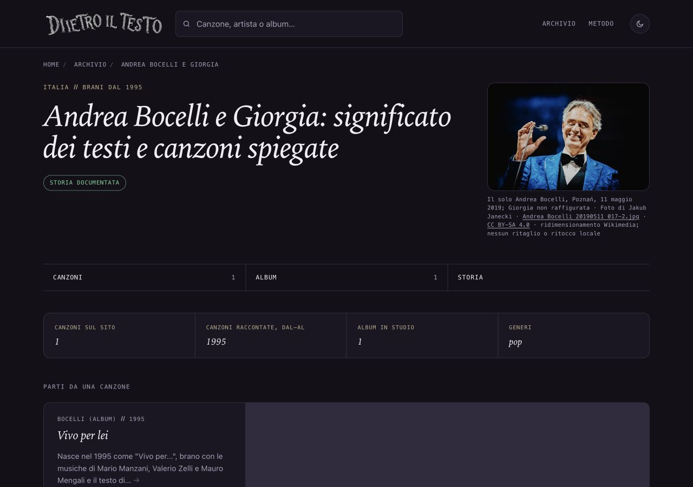

# Andrea Bocelli e Giorgia — fotografia del solo Bocelli, 14 ottobre 2026

## Osservazione e scelta

La scheda del duetto non ha una fotografia. Questo lotto prepara un’immagine pertinente del solo Andrea Bocelli, senza attribuirla a Giorgia o alla registrazione di Vivo per lei. Il limite è dichiarato nel credito. Fotografia osservata: Bocelli al microfono, sorridente, con giacca blu, papillon nero e una mano alzata. Non una ricostruzione o una foto generata.

## Provenienza e licenza

Autore e titolare dichiarato: Jakub Janecki. Titolo: Andrea Bocelli 20190511 017-2.jpg. [Pagina originale Commons](https://commons.wikimedia.org/wiki/File:Andrea_Bocelli_20190511_017-2.jpg), opera propria e dichiarazione di titolarità riaperte il 14 ottobre 2026. Scatto allo Stadion Poznań l’11 maggio 2019 secondo la pagina originale; caricamento il 13 aprile 2021. La lavorazione Lightroom indicata nei metadati originali appartiene al fotografo: non si afferma che il file sia privo di elaborazioni alla fonte.

[CC BY-SA 4.0 International](https://creativecommons.org/licenses/by-sa/4.0/) riaperta: riuso commerciale e adattamenti consentiti, con attribuzione, fonte, licenza e indicazione delle modifiche. Derivati con la stessa licenza o una compatibile; nessuna restrizione aggiuntiva o implicazione di sostegno. Non si usano autorizzazioni non documentate, fair use o licenze NC/editoriali.

[Originale 5448×3632](https://upload.wikimedia.org/wikipedia/commons/f/f2/Andrea_Bocelli_20190511_017-2.jpg). [Versione proporzionale Wikimedia 960×640 adottata](https://thumb.wikimedia.org/wikipedia/commons/thumb/f/f2/Andrea_Bocelli_20190511_017-2.jpg/960px-Andrea_Bocelli_20190511_017-2.jpg): JPEG, 102766 byte, SHA256 e2007a3540131c86de99fd9dc56b5aaeade974fa0eacc5563eb204a9bd996472. Due download identici, formato e dimensioni verificati; file ispezionato visivamente. Nessun ritaglio o ritocco locale; non si usa il distinto derivato ritagliato presente su Commons.

## Uso e testo accessibile

Pagina: /artista/andrea-bocelli-e-giorgia/. Asset: ritratti/andrea-bocelli-poznan-2019.jpg. Stesso JPEG nella figura, in og:image e in twitter:image. La pagina artista condivide il link; non contiene il generatore Instagram/Storia delle canzoni. Cache e ritagli delle piattaforme social restano esterni al sito.

Credito visibile: Il solo Andrea Bocelli, Poznań, 11 maggio 2019; Giorgia non raffigurata · Foto di Jakub Janecki · Andrea Bocelli 20190511 017-2.jpg · CC BY-SA 4.0 · ridimensionamento Wikimedia; nessun ritaglio o ritocco locale.

Alt: Andrea Bocelli in giacca blu e papillon nero, sorridente accanto al microfono con una mano alzata; fotografia a colori durante un concerto.

## File toccati e date

Nuovo asset, sola nuova chiave andrea-bocelli-e-giorgia in dati/ritratti.json, unico HTML artista/andrea-bocelli-e-giorgia/index.html, sola voce in sitemap-artisti.xml, dossier/prove e ROADMAP §113. Un solo dateModified/lastmod: 17 settembre → 14 ottobre 2026. datePublished, titolo, description, H1, canonical, biografia, fonti editoriali e CTA preservati. Solo la griglia mobile corrente del template applicata a questa pagina. Altri 697 HTML tracciati, cinque sitemap e 58 ritratti precedenti intatti. Nessun generatore, dato editoriale, cartolina o link Amazon modificato.

## Verifiche

F40 e protezioni contro modifiche massive delle date lette prima della generazione mirata. Nessun build generale. Script temporaneo rimosso. Confronto strutturale con la base: sole figura/metadati foto/data/griglia. SEO su 696 pagine, coerenza e link su 321 canzoni/104 artisti, 1065 affiliazioni e controllo crediti/asset/alt/dimensioni/casi negativi: tutti positivi. Diff controllato, esclusa soltanto la copia immutata del sorgente esterno da eventuali spazi del documento originale.

Browser: 1280×900, 390×844 e 320×568 in tema scuro; 320 anche chiaro. Nessun overflow orizzontale o ingrandimento della foto, credito e collegamenti leggibili. Screenshot desktop/mobile e credito stretto visionati. Foto circa 300×201 su desktop e 280×187 su mobile. Licenza aperta da tastiera e ritorno alla pagina verificati. Zero errori locali; errore classList del sito esterno Creative Commons registrato separatamente. Non una nuova verifica integrale della biografia.

## Copia e autorizzazioni

Copia riusata dopo la pubblicazione verificata di Rino: /Users/gianmicheletroisi/.codex/worktrees/ritratto-rino-gaetano-2026-10-14/dietro-il-testo. Nuovo ramo codex/ritratto-bocelli-giorgia-2026-10-14, base 53ffeaf5245b45a895026cb58046bdf9a778afa1. Main e non tracciati preservati; copia dell’altra AI e rapporti 16–46 lasciati intatti, senza nuovi rapporti. Finley, De André e prototipo What’s My Age Again? restano sui propri rami in revisione; 308 cartoline ferme. Registri delle copie e timeout conservati nelle prove. Nessuna nuova copia o modifica alle copie non accessibili.

Nirvana lasciata alla ricerca proposta all’altra AI; non è arrivato un nuovo rapporto. Unire soltanto la nuova chiave Bocelli/Giorgia e §113 senza sostituire l’intero JSON o ROADMAP. Commit locale dopo verifiche; integrazione nel main, push e pubblicazione richiedono approvazione specifica. Nessun GSC, indicizzazione o nuovo Amazon. Limite principale: il soggetto è il solo Bocelli in concerto nel 2019, non il duetto.

## Pubblicazione approvata e verificata — 14 ottobre 2026

Approvazione nominativa del proprietario: «Approvo Bocelli 132ab77dc: integrazione, push e pubblicazione». Main avanzato direttamente da 53ffeaf52 all’esatto commit 132ab77dc5833fb1f66449dfe05c130734c248eb; push riuscito. Nessuna modifica ulteriore al sito o alle date.

Il deployment di produzione 5sVt5vNp7ghH3Y4HTjC8jZWpKuJ2 è READY/Current su www.dietroiltesto.it, sorgente main e commit 132ab77dc. Concluso il 14 ottobre 2026 alle 19:52:35 CEST, durata 19 secondi. URL tecnico dietro-il-testo-pnc2wqnmt-giantroisi1.vercel.app; controllo GitHub Vercel success. Il connettore Vercel negava l’accesso; la verifica del pannello è stata completata tramite browser dopo il login effettuato dal proprietario.

Attesa dovuta a un vecchio build di preview Ora torna, ChA7JJJ9VW3TP7mdbGt9L27kD6iu, 1d44964, segnato Stale. Dopo autorizzazione specifica «Annulla solo il vecchio build di anteprima», annullato e verificato Canceled alle 19:52:15 CEST. Non modificati nuovi deployment, codice, produzione o piano dell’altro progetto. Sblocco della coda seguito da conclusione automatica di Bocelli, senza altro push o deployment.

Pagina HTML, JPEG e sei sitemap effettive confrontati byte per byte sul dominio pubblico tramite HTTPS con verifica TLS attiva: tutti identici al lotto approvato. Unico lastmod artista al 14 ottobre già previsto nel lotto, cinque sitemap precedenti e altre date preservate. Il controllo iniziale aveva interrogato due nomi sitemap non presenti nel repository: corretti usando l’elenco reale, non una regressione del sito. Python non disponeva dell’emittente CA locale: usato curl di sistema, senza insecure.

Browser online 1280×900, 390×844, 320×568: JPEG caricato 960×640, nessun ingrandimento o overflow orizzontale, alt e credito presenti, stessa immagine figura/OG/Twitter, zero errori o avvisi. Screenshot desktop e mobile visionati. Le precedenti prove locali includono anche tema chiaro e licenza da tastiera. Limite invariato e dichiarato: solo Bocelli, senza Giorgia.

Prove aggiunte soltanto su ramo locale codex/bocelli-prove-pubblicazione-2026-10-14, senza un secondo push. Main e origin/main restano 132ab77dc, file non tracciati con hash originali, altra AI e proposte preservati. Pubblicazione fotografica completata; nessuna autorizzazione residua per questo lotto.
