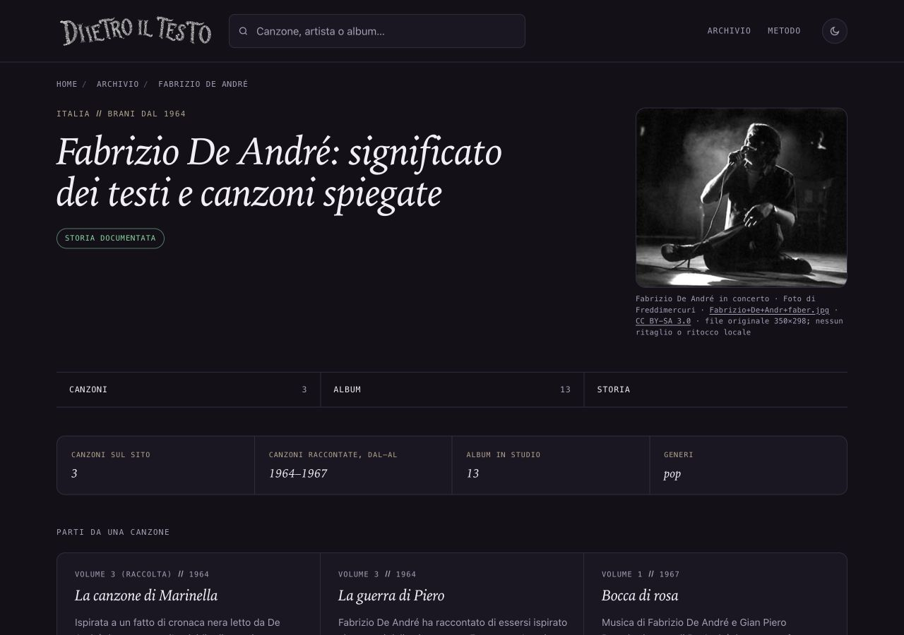

# Fabrizio De André — fotografia, 13 ottobre 2026

## Problema e proposta

La pagina artista mostra ancora il riquadro privo di fotografia. Proposta: Fabrizio De André seduto sul palco a gambe incrociate, microfono in mano, fotografia in bianco e nero. File ispezionato visivamente e soggetto coerente con la descrizione della pagina originale. Nessuna altra scheda editoriale o cartolina modificata.

## Licenza e provenienza

[Pagina originale Commons](https://commons.wikimedia.org/wiki/File:Fabrizio%2BDe%2BAndr%2Bfaber.jpg) e [licenza CC BY-SA 3.0 Unported](https://creativecommons.org/licenses/by-sa/3.0/) riaperte il 13 ottobre 2026. Autore e titolare dichiarato: Freddimercuri; fonte: opera propria; titolo: Fabrizio+De+Andr+faber.jpg. Sono consentiti riuso commerciale e adattamenti, con attribuzione, fonte, titolo e licenza, indicazione delle modifiche, stessa licenza o compatibile per derivati, nessuna restrizione aggiuntiva o sostegno implicato. Autore e titolarità sono quelli dichiarati nella pagina originale, senza conferma indipendente.

[File originale](https://upload.wikimedia.org/wikipedia/commons/3/3b/Fabrizio%2BDe%2BAndr%2Bfaber.jpg): 350×298, 15.131 byte; SHA256 74b445e37858e4a27bc58cc90bf5ed08d53e0c7dbbc3e0c0354982c80a98c060. Nessuna trasformazione del file, ritaglio o ritocco. URL, autore/titolare, titolo, obblighi, controllo, uso, modifiche, credito visibile e alt completi in provenienza.json e nella nuova chiave fabrizio-de-andre di dati/ritratti.json.

Limiti: la descrizione Commons indica un concerto nel 1998; la data 2012 del file è quella del caricamento. Anno e luogo dello scatto non confermati, quindi non dichiarati nel credito o nel testo alternativo. Risoluzione modesta, mantenuta senza ingrandimento. La prima candidata Fabrizio de Andre.jpg, apparentemente libera in Italia ma dichiarata protetta negli Stati Uniti, è stata esclusa; nessun suo file entra nella proposta.

## Foto in pagina e condivisione

Uso /artista/fabrizio-de-andre/. Lo stesso JPEG locale compare nella figura, Open Graph e Twitter: nessuna diversa grafica. La pagina artista condivide il link, senza i formati Instagram/Storia delle canzoni. Ritagli e cache delle anteprime dipendono dalle piattaforme. Contenuto fotografico 298×254 su desktop e 278×237 su mobile; file naturale 350×298. Credito visibile: Fabrizio De André in concerto · Foto di Freddimercuri · Fabrizio+De+Andr+faber.jpg · CC BY-SA 3.0 · file originale 350×298; nessun ritaglio o ritocco locale.

## File toccati e date

Nuovo asset ritratti/fabrizio-de-andre.jpg e sola nuova chiave del registro; artista/fabrizio-de-andre/index.html, sitemap-artisti.xml, questa documentazione e ROADMAP §107. DateModified e lastmod del solo artista dal 17 settembre al 13 ottobre 2026. DatePublished, titolo, H1, description, canonical, testi e collegamenti preservati. Confronto rigoroso su 697 HTML tracciati, inclusa una prova originale: un HTML artista cambiato e 696 file intatti; altri cinque sitemap e 54 ritratti precedenti intatti. Tutte le cartoline, dati editoriali, computati, ricerca, affiliazioni e generatori preservati.

Generazione mirata dopo lettura della protezione F40, nessun build generale. Solo questa pagina riceve la griglia mobile già presente nel template corrente. Le differenze consentite sono fotografia, credito/metadati, data e questa griglia; nessuna differenza editoriale.

## Verifiche

SEO: 696 pagine, zero problemi; link: 321 canzoni e 104 artisti, zero problemi; affiliazioni: 1065 link, zero problemi. Prove creditizie positive e negative e hash degli asset superati. Browser 1280×900, 390×844, 320×568 e tema chiaro a 320: caricamento, credito e metadati corretti, zero overflow, nessun errore console, nessun ingrandimento. Prove archiviate in rapporti/prove-ritratto-fabrizio-de-andre-2026-10-13/.

## Copia e integrazione

Copia /Users/gianmicheletroisi/.codex/worktrees/ritratto-de-andre-2026-10-13/dietro-il-testo; ramo codex/ritratto-de-andre-2026-10-13, base 53ce54c76. Checkout creato dall'app; registrazione e riaggancio dell'allegato falliti per il limite di 100 allegati. Copia unica conservata.

Stato delle 36 copie controllato: 12 timeout e una voce remota assente conservati, senza intervenire nelle copie. Main e due documenti non tracciati intatti, copia dell'altra AI preservata. Rapporti letti come segnalazioni, nessuna nuova correzione editoriale dedotta. Teen Spirit 53ce54c76 già pubblicato; documentazione faad6477c locale. Finley e067af381 e prototipo What’s My Age Again? 6f5d86e4b restano in revisione; altre 308 cartoline ferme. Nessun GSC o indicizzazione, nessun nuovo Amazon.

Solo commit locale dopo verifica. Integrazione, push e pubblicazione richiedono approvazione nominativa per questo lotto. Integrare soltanto la nuova chiave fabrizio-de-andre e §107 della Roadmap, preservando chiavi e sezioni delle altre proposte.
