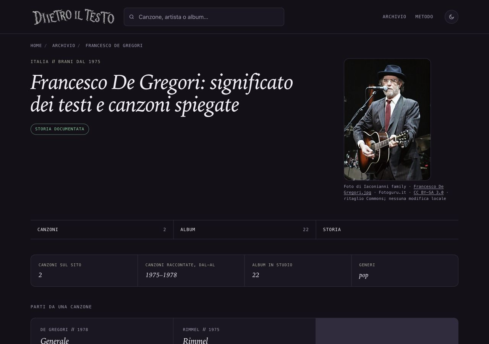

# Francesco De Gregori — fotografia, 13 ottobre 2026

## Problema e proposta

La pagina artista mostra il riquadro senza fotografia. File scelto: Francesco De Gregori al microfono con chitarra acustica, cappello scuro, occhiali e abito gessato. Soggetto controllato visivamente e coerente con la descrizione originale. Il registro di tutti i rami locali non contiene già il ritratto; la vecchia copia del 26 settembre non esiste sul filesystem. Le proposte di altri artisti restano indipendenti.

## Prove e licenza

[Pagina originale Commons](https://commons.wikimedia.org/wiki/File:Francesco_De_Gregori.jpg) riaperta via HTTPS il 13 ottobre 2026: autore Iaconianni family, fonte Fotoguru.it, marzo 2008. Titolo Francesco De Gregori.jpg. È pubblicata la conferma Wikimedia VRT dell'autorizzazione del titolare, ticket 2008042810014876; la corrispondenza è riservata ai volontari e non è stata letta direttamente. Non si attribuisce al caricatore Dread83 la paternità della foto.

[CC BY-SA 3.0 Unported](https://creativecommons.org/licenses/by-sa/3.0/) riaperta: riuso commerciale e adattamenti consentiti, con autore/titolo/fonte/licenza, indicazione delle modifiche, stessa licenza o compatibile per derivati, nessuna restrizione aggiuntiva o implicazione di sostegno.

[File](https://upload.wikimedia.org/wikipedia/commons/d/d5/Francesco_De_Gregori.jpg) 318×447, 90.447 byte. SHA256 in provenienza.json e nuova chiave francesco-de-gregori del registro. File Commons già indicato come ritaglio dell'immagine Fotoguru; nessuna ulteriore modifica locale. Registro completo: autore/titolare secondo attribuzione e conferma VRT, titolo, originali e file, licenza/versione, obblighi, data, uso, modifiche, credito visibile e alt. Luogo dello scatto non dichiarato; marzo 2008 è la data riportata su Commons, senza ulteriore ricostruzione.

## Stessa immagine in pagina e condivisione

Uso /artista/francesco-de-gregori/. Identico JPEG nella figura, in Open Graph e Twitter. Nessuna diversa grafica. La pagina artista condivide il link; non ha i formati Instagram/Storia delle canzoni. Cache e ritagli delle anteprime dipendono dalle piattaforme.

Credito visibile: Foto di Iaconianni family · Francesco De Gregori.jpg · Fotoguru.it · CC BY-SA 3.0 · ritaglio Commons; nessuna modifica locale. Alt: Francesco De Gregori al microfono con chitarra acustica, cappello scuro, occhiali e abito gessato. Foto intera, resa circa 228×320 desktop e 235×330 mobile, inferiore al file 318×447.

## File toccati e variazioni di data

Nuovo ritratti/francesco-de-gregori.jpg e sola chiave nel registro; artista/francesco-de-gregori/index.html; sola voce sitemap-artisti.xml, dossier/prove e ROADMAP §108. DateModified/lastmod del solo artista dal 17 settembre al 13 ottobre 2026. DatePublished, titolo, H1, description, canonical, testo editoriale e collegamenti invariati.

Confronto rigoroso su 697 HTML tracciati: un HTML artista cambiato e 696 file intatti, inclusa una prova originale. Cinque sitemap e 54 ritratti precedenti intatti. Dati editoriali, computati, ricerca, affiliazioni, cartoline e generatori intatti. Solo griglia mobile del template corrente applicata alla singola pagina. F40 letta prima della generazione mirata; nessun build generale.

## Verifiche

SEO 696 pagine, link 321 canzoni/104 artisti e 1065 affiliazioni: zero problemi. Prove crediti positive/negative e hash superati. Browser 1280×900, 390×844, 320×568 e tema chiaro 320: foto caricata, credito visibile, stesso file nei metadati, nessun ingrandimento/overflow o errore console. Credito mobile ispezionato separatamente.

## Copia, limiti e autorizzazioni

Copia /Users/gianmicheletroisi/.codex/worktrees/ritratto-de-gregori-2026-10-13/dietro-il-testo; ramo codex/ritratto-de-gregori-2026-10-13; base 53ce54c76. Registrazione e riaggancio app falliti al limite 100 allegati; unica copia creata, preservata.

37 copie controllate prima della preparazione: 12 timeout conservati e voce remota assente lasciata nel registro. Main e due documenti SEO non tracciati preservati, copia dell'altra AI intatta. Rapporti letti come segnalazioni; nessuna nuova correzione editoriale dedotta. Teen Spirit già pubblicato, prove faad6477c locali. Finley e067af381, De André 7fb17c9a3 e prototipo What’s My Age Again? 6f5d86e4b restano in revisione. Altre 308 cartoline ferme. Nessun GSC/indicizzazione o nuovo Amazon.

Limiti: file piccolo e già ritagliato alla fonte, usato senza ingrandimento. Autorizzazione basata sulla conferma VRT pubblica, non sulla lettura della corrispondenza privata. Nessuna nuova attestazione integrale della biografia.

Solo commit locale dopo verifiche. Integrazione nel main, push e pubblicazione richiedono approvazione nominativa. Integrare sola chiave francesco-de-gregori e §108 della Roadmap; non sovrascrivere altri JSON o sezioni delle proposte.
