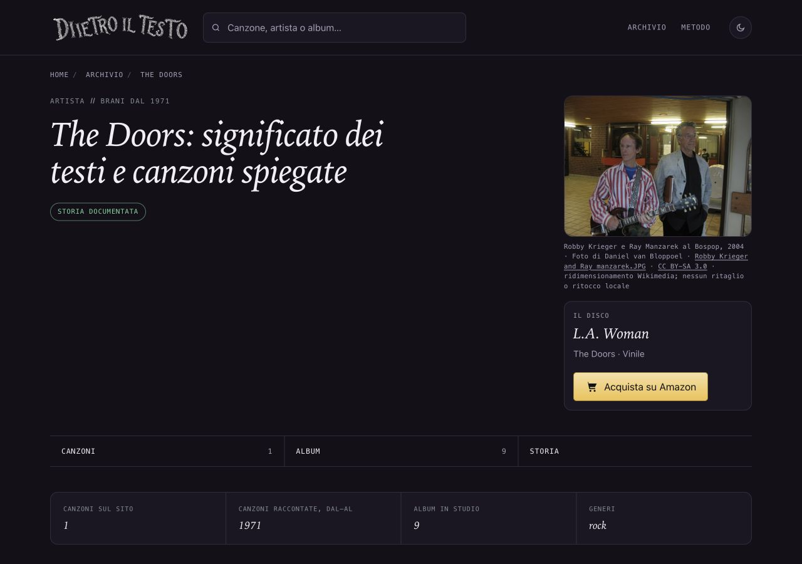

# The Doors — foto di Robby Krieger e Ray Manzarek, 13 ottobre 2026

## Osservazione e immagine

La pagina artista non ha fotografia. Ricerca indipendente dopo controllo di main,38copie e rami fotografici; nessuna proposta Doors precedente. Foto di Robby Krieger con chitarra a sinistra e Ray Manzarek con occhiali a destra, al Bospop di Weert nel2004 secondo la fonte. Originale controllato visivamente. Non mostra Jim Morrison o John Densmore, né la formazione completa o attuale. Non si descrive come una performance sul palco: la foto mostra i due musicisti in un ambiente interno al festival.

## Prove di provenienza e licenza

[Pagina originale dell'autore](https://commons.wikimedia.org/wiki/File:Robby_Krieger_and_Ray_manzarek.JPG), riaperta il13ottobre2026, dichiara opera propria e titolarità di Daniel van Bloppoel, utenteDvB33. Titolo Robby Krieger and Ray manzarek.JPG; data8luglio2004, originale2272×1704. Nessun passaggio da Flickr/social o autorizzazione presunta. Copia integrale della pagina conservata come .txt, non come HTML indicizzabile.

[CC BY-SA3.0 Unported](https://creativecommons.org/licenses/by-sa/3.0/), riaperta: copia e adattamenti anche commerciali consentiti; autore/titolo/fonte/licenza, indicazione modifiche, stessa licenza o compatibile per derivati, nessuna restrizione aggiuntiva o implicazione di sostegno. Licenza originale confermata dalla dichiarazione dell'autore sulla pagina, non soltanto dalle categorie Commons.

[Originale](https://upload.wikimedia.org/wikipedia/commons/3/39/Robby_Krieger_and_Ray_manzarek.JPG). [Asset Wikimedia960×720](https://thumb.wikimedia.org/wikipedia/commons/thumb/3/39/Robby_Krieger_and_Ray_manzarek.JPG/960px-Robby_Krieger_and_Ray_manzarek.JPG): ridimensionamento proporzionale Wikimedia, nessun ritaglio o ritocco locale. Dimensioni/byte/hash in provenienza.json. Autore/titolare/titolo/pagine/URL/licenza/obblighi/data/uso/modifiche/credito/alt registrati nella nuova sola chiave the-doors.

## Uso e credito visibile

/artista/the-doors/. Stesso JPEG nella figura e in OG/Twitter, opzione esplicita stessaImmagineCondivisione. La pagina artista condivide il link; non ha formati Instagram/Storia delle canzoni. Cache e ritagli delle anteprime dipendono dalle piattaforme.

Credito: Robby Krieger e Ray Manzarek al Bospop,2004 · Foto di Daniel van Bloppoel · Robby Krieger and Ray manzarek.JPG · CC BY-SA3.0 · ridimensionamento Wikimedia; nessun ritaglio o ritocco locale. Link visibili alla fonte e licenza.

Alt: Robby Krieger con chitarra a sinistra e Ray Manzarek a destra al Bospop di Weert nel2004; due membri dei Doors, non la formazione completa.

## File toccati e date

Nuovo ritratti/the-doors-krieger-manzarek-2004.jpg, sola chiave nel JSON ritratti, artista/the-doors/index.html, unica voce sitemap-artisti.xml, dossier/prove e Roadmap§109. Solo dateModified/lastmod Doors dall'11al13ottobre2026. DatePublished, titolo/H1/description/canonical/editoriale/CTA invariati. Solo griglia mobile già nel template applicata alla singola pagina.55ritratti precedenti e altre697HTML tracciati invariati, cinque sitemap identici. Generatori, computati, ricerca e cartoline intatti. F40 letta prima della generazione mirata, nessun build generale.

## Verifiche

Skill Vercel verification applicata alla storia completa registro→HTML→foto/credito→metadati: caricamenti locali200, hash e dimensioni, crediti positivi/negativi, SEO696pagine, link321/104 e1065affiliazioni senza problemi. Browser1280×900/390×844/320×568 scuro e320chiaro: foto300×225 desktop,280×210 mobile, nessun ingrandimento/overflow/errori. Screenshot390ricatturato dopo assestamento della vista; prima cattura transitoria scalata esclusa. Credito leggibile nel desktop e mobile390. Nessuna attestazione di verifica integrale editoriale.

## Copia, integrazione e limiti

Copia /Users/gianmicheletroisi/.codex/worktrees/ritratto-doors-2026-10-13/dietro-il-testo, ramo codex/ritratto-doors-2026-10-13, base5d61deae7. Checkout unico: registrazione e riaggancio app falliti al limite100allegati.38copie controllate;12timeout e voce remota assente conservati. Main e due documenti SEO non tracciati preservati. AltraAI/rapporti16–46 intatti, nessun nuovo errore editoriale dedotto. Finley, DeAndré, prototipo What's My Age Again? e altri lotti fotografici pendenti preservati;308cartoline ferme.

Limiti: foto dei soli due membri al festival2004, leggermente morbida nell'originale, non immagine storica della formazione completa. Nessun volto assente ricostruito. Solo commit locale dopo verifiche; integrazione/main/push/pubblicazione richiedono approvazione nominativa. Unire soltanto chiave the-doors e§109 senza sovrascrivere altri JSON/sezioni; il piccolo hunk della griglia è sulla sola pagina. Nessun GSC/IndexNow o nuovo Amazon.

## Pubblicazione approvata e verificata — 13 ottobre 2026

Approvazione diretta del proprietario per integrazione nel main, push e pubblicazione di Doors 36014659a, con i limiti dichiarati. Fast-forward da 5d61deae7 e push del solo commit 36014659aac2146dc2c98c20493efb1878c5ebb9. Deploy dpl_D4Nb197fcWtq2vG8xfVEeTMN6bEm READY production, fonte Git/main e SHA confermati dal connettore Vercel; alias www.dietroiltesto.it e dietroiltesto.it presenti, nessun aliasError. Progetto/team e file locale .vercel coerenti.

Pagina Doors, JPEG e sei sitemap HTTPS identici byte per byte a main, TLS attivo. Browser online 1280×900, 390×844, 320×568: foto caricata 960×720, stessa sorgente in figura/OG/Twitter, credito completo leggibile, resa circa 300×225 desktop e 280×210 mobile, nessun ingrandimento, overflow o errore console. Screenshot desktop e mobile ispezionati. Limiti invariati: fotografia dei soli Krieger e Manzarek nel 2004, leggermente morbida alla fonte; nessuna implicazione di formazione completa. Cache/ritagli delle anteprime restano dipendenti dalle piattaforme.

Unico lastmod/dateModified cambiato: artista/the-doors/, dall'11 al 13 ottobre 2026. DatePublished e altre date preservate; nessun build o rigenerazione aggiuntivi. Hash dei due documenti SEO non tracciati invariati. Copie Finley e067af381, De André 7fb17c9a3 e prototipo cartolina 6f5d86e4b pulite e inalterate; De Gregori e prove 2210c93c7 preservati. Nessuna modifica alla copia dell'altra AI, GSC/IndexNow o nuovi link Amazon. Le altre 308 cartoline restano ferme.

Prove successive al deploy archiviate in rapporti/prove-ritratto-doors-2026-10-13/pubblicazione e nel ramo locale codex/doors-prove-pubblicazione-2026-10-13. Nessun secondo push: l'approvazione riguardava il lotto 36014659a; l'eventuale invio di queste sole prove successive resta da autorizzare. Controllo spazi positivo sui file preparati, esclusa soltanto la prova Commons originale .txt mantenuta integra. Filone concluso: foto Doors pubblicata e verificata.
