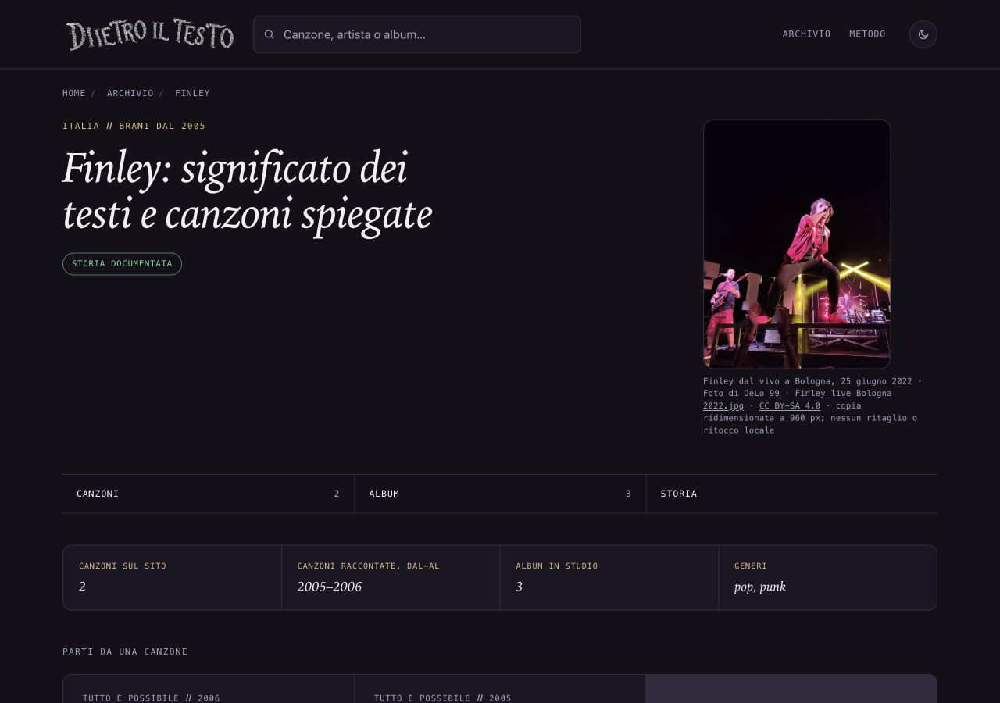

# Finley — fotografia dal vivo, 13 ottobre 2026

## Problema e proposta

La pagina artista Finley mostra ancora il riquadro senza immagine. Foto pertinente: concerto al Mercato degli Ulivi, Parco delle Caserme Rosse, Bologna, 25 giugno 2022. Cantante al microfono in primo piano, bassista e batterista visibili sul palco; non ritratto completo della formazione. Soggetto controllato visivamente, nessun riconoscimento personale aggiuntivo introdotto.

## Prove e licenza

[Pagina originale Commons](https://commons.wikimedia.org/wiki/File:Finley_live_Bologna_2022.jpg), riaperta via HTTPS il 13 ottobre 2026: autore DeLo 99, opera propria, titolare dichiarato DeLo 99, titolo Finley live Bologna 2022.jpg, CC BY-SA 4.0 International. [Licenza riaperta](https://creativecommons.org/licenses/by-sa/4.0/): riuso anche commerciale e adattamenti consentiti; obblighi di attribuzione, fonte/licenza, indicazione delle modifiche, medesima licenza per derivati, nessuna restrizione aggiuntiva o sostegno implicato.

Originale 3000×4000: https://upload.wikimedia.org/wikipedia/commons/5/5e/Finley_live_Bologna_2022.jpg. Asset Wikimedia 960×1280: https://thumb.wikimedia.org/wikipedia/commons/thumb/5/5e/Finley_live_Bologna_2022.jpg/960px-Finley_live_Bologna_2022.jpg. File, byte, SHA256, autore, titolare, titolo, fonti, licenza/versione, obblighi, alt, credito visibile, pagina d'uso e modifiche registrati in provenienza.json e nella nuova chiave finley di dati/ritratti.json. Solo ridimensionamento Wikimedia; nessun ritaglio o ritocco locale. Pagina d'uso /artista/finley/.

Prima candidata Finley2.jpg/Alcatraz2007: CC BY2.0 confermata anche nel Flickr originale, ma scartata perché musicisti troppo scuri per buona riconoscibilità. Nessun asset di quel candidato entra nel sito. Le ricerche non pertinenti ai Finley sono state escluse.

## Stessa immagine in pagina e condivisione

ritratti/finley.jpg compare in foto, Open Graph e Twitter, senza creare una diversa cartolina. La pagina artista condivide il link; non ha i formati Instagram/Storia delle canzoni. Ritaglio e cache della preview dipendono dalle piattaforme. Foto mostrata intera e proporzionale: 240×320 desktop,248×330 mobile, nessun ingrandimento.

## Ambito e verifiche

Nuova chiave finley, asset, una pagina artista e una voce sitemap. Solo dateModified/lastmod Finley dal17settembre al13ottobre2026; datePublished, titolo/description/H1/canonical, testi e collegamenti preservati. Tutti54ritratti precedenti,695HTML,5sitemap, dati editoriali, ricerca, affiliazioni e cartoline intatti. Nessun template modificato. La singola pagina riceve la protezione della griglia mobile già nel template corrente; altre pagine non rigenerate. Nessun build generale o modifica dei computati, F40 letta e usata prima della generazione mirata.

SEO696 e link321/104 senza problemi;1065link affiliati preservati. Crediti e hash degli asset, inclusi casi di esclusione dei crediti incompleti, positivi. Browser1280/390/320 e tema chiaro320: immagine caricata, crediti visibili, zero overflow/errori. Confronto rigoroso limita le differenze alla foto, suoi metadati, data e griglia già presente nel template.

## Copia, limiti e autorizzazioni

Copia /Users/gianmicheletroisi/.codex/worktrees/ritratto-finley-2026-10-13/dietro-il-testo, ramo codex/ritratto-finley-2026-10-13, base4b7933706. Creata dall'app; registrazione dell'allegato fallita al limite100, riaggancio tentato senza creare duplicati. I lotti53ce54c76 TeenSpirit e6f5d86e4b cartolina curata sono separati e intatti. Altre308cartoline ferme.

Stato35copie controllato;12timeout e remoto assente preservati. Copia dell'altraAI intatta. Main e file non tracciati preservati. Nessun GSC/IndexNow. Non è una nuova verifica editoriale della biografia. Limite fotografico: immagine dal vivo del2022, non la formazione completa né il periodo2005–2007 delle canzoni presenti.

Solo commit locale dopo verifiche. Per integrare usare la sola chiave finley e sezione106Roadmap, preservando voci dei JSON e sezioni di altre proposte. Integrazione, push e pubblicazione richiedono approvazione specifica.
