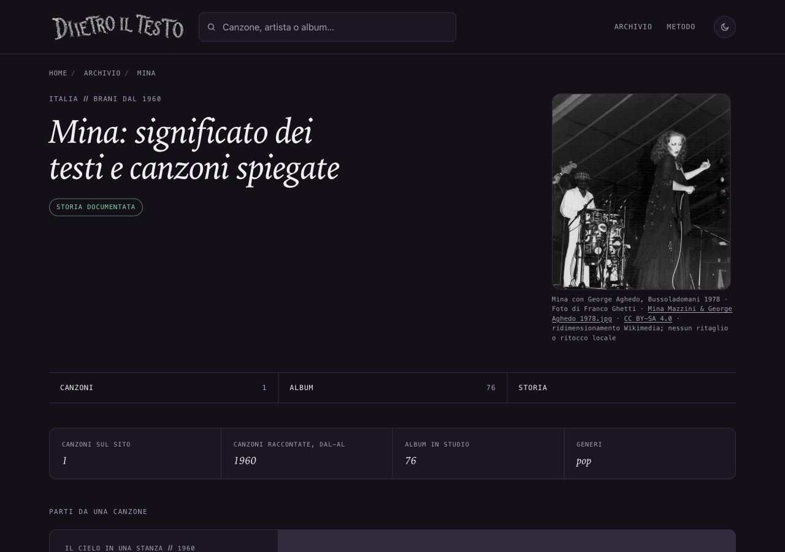

# Mina — fotografia di Bussoladomani, 14 ottobre 2026

## Osservazioni e proposta

La pagina artista manca di fotografia. Ricerca dedicata alla sola Mina, dopo lettura della Costituzione, Roadmap recente e stato delle copie/rami. Nessuna voce Mina nel registro principale o nei rami locali, nessun lotto Mina in revisione. Originale controllato visivamente: Mina con microfono e abito scuro a destra, George Aghedo alle congas a sinistra. Si mantiene il secondo musicista e il contesto della performance, senza ritaglio.

## Prove, autore e licenza

[Pagina originale dell’autore](https://commons.wikimedia.org/wiki/File:Mina_Mazzini_%26_George_Aghedo_1978.jpg) riaperta il 14 ottobre 2026. Titolo: Mina Mazzini & George Aghedo 1978.jpg. Autore/titolare dichiarato: Franco Ghetti. La scheda dichiara opera propria e pubblicazione da parte del titolare; data luglio 1978, Bussoladomani. Caricamento del fotografo nel2020. Metadati digitali2019 non usati come data dello spettacolo.

La pagina offre GFDL e [CC BY-SA 4.0 International](https://creativecommons.org/licenses/by-sa/4.0/), riaperta: si sceglie quest’ultima. Copia/distribuzione e adattamenti anche commerciali consentiti; attribuzione con fonte/licenza, indicazione modifiche, derivati con stessa licenza o compatibile, nessuna restrizione aggiuntiva o implicazione di sostegno. Nessun ricorso a fair use, NonCommercial o autorizzazione presunta. Copia integrale della pagina originale conservata come .txt per evitare di indicizzarla come pagina del sito.

[File originale](https://upload.wikimedia.org/wikipedia/commons/8/8a/Mina_Mazzini_%26_George_Aghedo_1978.jpg), 1423×1563. [Asset Wikimedia](https://thumb.wikimedia.org/wikipedia/commons/thumb/8/8a/Mina_Mazzini_%26_George_Aghedo_1978.jpg/960px-Mina_Mazzini_%26_George_Aghedo_1978.jpg), 960×1054: ridimensionamento proporzionale alla fonte, nessun ritaglio o ritocco locale. Byte/hash registrati in provenienza.json e chiave mina del registro. Registro completo: autore, titolare, titolo, pagina originale, URL originale/asset, licenza/versione, obblighi, data, uso, modifiche, credito e alt.

## Uso e identità della condivisione

Pagina /artista/mina/. Stesso JPEG nella figura e nei metadati OG/Twitter, con opzione esplicita stessaImmagineCondivisione. La pagina artista condivide il link e non dispone dei formati Storia delle pagine canzone. Cache e ritagli delle anteprime dipendono dalle piattaforme.

Credito visibile: Mina con George Aghedo, Bussoladomani1978 · Foto di Franco Ghetti · Mina Mazzini & George Aghedo1978.jpg · CC BY-SA4.0 · ridimensionamento Wikimedia; nessun ritaglio o ritocco locale. Collegamenti alla pagina originale e alla licenza.

Alt: Mina in abito scuro con un microfono, a destra, e il percussionista George Aghedo alle congas, a sinistra, sul palco di Bussoladomani nel1978; fotografia in bianco e nero.

## File toccati e variazioni attese delle date

Nuovo ritratti/mina-bussoladomani-1978.jpg, sola chiave mina in dati/ritratti.json, artista/mina/index.html, unica voce sitemap-artisti.xml, dossier/prove e Roadmap§110. DateModified/lastmod Mina dal17settembre al14ottobre2026. DatePublished, titolo/H1/description/canonical, editoriale e CTA preservati. Solo griglia mobile del template corrente applicata sulla singola pagina. Altre697HTML tracciate e cinque sitemap identiche;56ritratti precedenti intatti. Dati editoriali/computati, generatori, ricerca e cartoline invariati. Protezioni F40 rilette prima della generazione mirata; nessun build generale.

## Verifiche

Hash/dimensioni/credito positivo e negativo, SEO696pagine, link321canzoni/104artisti,1065affiliazioni: zero problemi. Skill Vercel verification applicata al percorso registro→HTML→foto/credito→OG/Twitter; caricamenti locali200, nessuna API/configurazione esterna coinvolta. Browser1280×900/390×844/320×568 scuro e320chiaro: stessa foto caricata960×1054, circa292×320desktop e280×307mobile, credito leggibile, zero overflow/errori e nessun ingrandimento. Screenshot desktop/mobile visionati. Non si dichiara una nuova verifica integrale della biografia.

## Copia, integrazione e limiti

Copia /Users/gianmicheletroisi/.codex/worktrees/ritratto-mina-2026-10-14/dietro-il-testo; ramo codex/ritratto-mina-2026-10-14; base36014659a. Registrazione e riaggancio app al limite100allegati falliti; unico checkout creato, nessuna copia duplicata.30copie controllate:12timeout e registro remoto assente preservati. Main e documenti SEO non tracciati invariati; altraAI e rapporti16–46 intatti, senza nuovi rapporti rispetto al ciclo precedente. I vecchi checkout non più presenti non sono stati ricreati/modificati; commit pendenti Finley e067af381, DeAndré7fb17c9a3 e prototipo6f5d86e4b ancora nei rami. Doors già pubblicato36014659a e prove localice5870be5 preservati.

Limiti: fotografia storica in bianco e nero con grana originale, performance con George Aghedo e non ritratto solitario. Data/luogo secondo dichiarazione del fotografo. Nessun ritocco o ricostruzione del volto. Le altre308cartoline restano ferme. Nessun GSC/IndexNow o nuovo Amazon.

Solo commit locale dopo verifica. Main, push e pubblicazione richiedono approvazione specifica del proprietario. Integrare soltanto nuova chiave mina e§110 della Roadmap, preservando le distinte voci/sezioni degli altri lotti. Il piccolo hunk della griglia riguarda solo l’HTML Mina.

## Pubblicazione approvata e verificata — 14 ottobre 2026

Approvazione nominativa del proprietario: Mina 5ea40016d, integrazione nel main, push e pubblicazione. Integrato e inviato esclusivamente il commit 5ea40016d6e33e73a75477d58b61b225d7614f03. Vercel dpl_441C9pL6gS37AUKf6uvAREyEVU8R READY, ambiente production, ramo main e SHA esatto; alias www.dietroiltesto.it attivo senza errori.

Pagina pubblica https://www.dietroiltesto.it/artista/mina/, JPEG e sei sitemap confrontati via HTTPS con TLS attivo: byte identici ai file approvati. Browser pubblico 1280×900, 390×844 e 320×568: foto caricata 960×1054, stessa URL in figura/OG/Twitter, credito Franco Ghetti/George Aghedo visibile, nessun overflow o errore console. Screenshot desktop e mobile visionati. Nessun build generale; unico lastmod/dateModified Mina al14ottobre, datePublished preservata.

Prove in rapporti/prove-ritratto-mina-2026-10-14/pubblicazione/. Main e documenti SEO non tracciati preservati; altri lotti e copia dell'altra AI intatti, 308cartoline ferme. Questa documentazione successiva è conservata su ramo locale codex/mina-prove-pubblicazione-2026-10-14, senza secondo push. Limiti della foto storica e cache/ritagli social restano quelli dichiarati.
