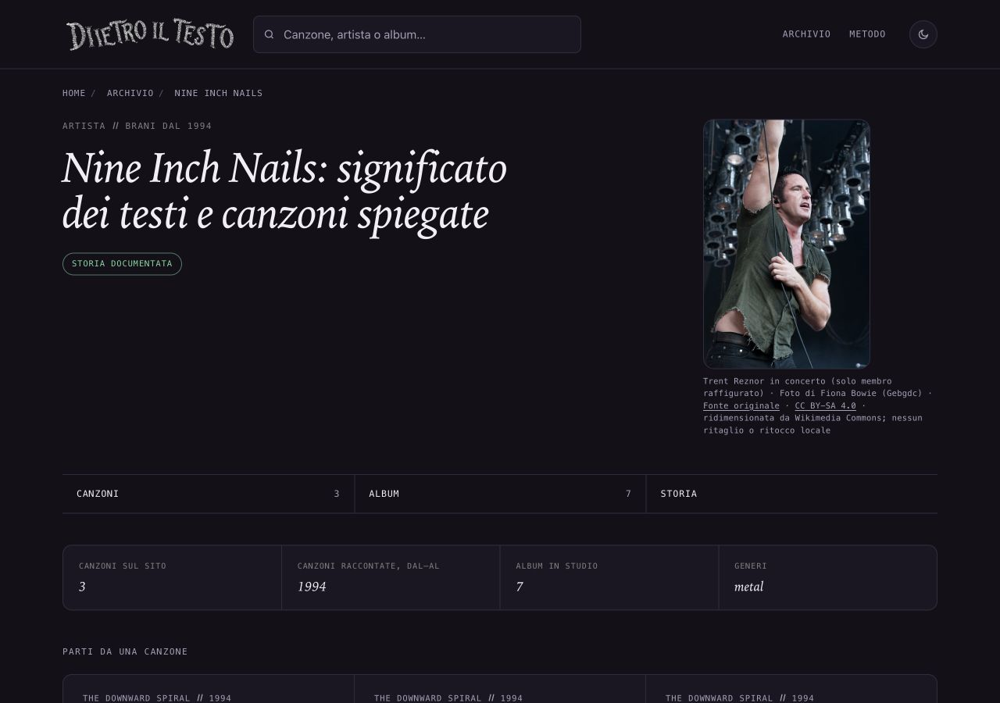

# Nine Inch Nails — nuova proposta fotografica, 15 ottobre 2026

## Osservazione e scelta

La pagina artista non ha una fotografia. Il proprietario ha chiesto di lasciare Battisti e passare a un altro soggetto senza toccare i lotti in revisione. Prima della scelta è stata letta la revisione NIN 9cb173a33: la vecchia foto di Manchester2022 è stata scartata il4ottobre per volti non riconoscibili. Quella candidatura è chiusa, non promossa; asset, rami e documenti precedenti sono rimasti intatti.

Nuova foto di Fiona Bowie/Gebgdc: Trent Reznor sul palco, camicia verde, braccio alzato, volto visibile e luci alle spalle. Il JPEG originale e quello adottato sono stati osservati, con riscontro sulla pagina pubblica di origine. Non rappresenta tutta la band: credito e alt lo dichiarano.

## Provenienza e diritti

Autrice e titolare dichiarata: Fiona Bowie (Gebgdc), opera propria pubblicata dall’autrice con dichiarazione del titolare sulla [pagina originale Commons](https://commons.wikimedia.org/wiki/File:Trent_Reznor_with_Nine_Inch_Nails_--_California,_21_May_2009.jpg). Titolo originale: Trent Reznor with Nine Inch Nails -- California, 21 May 2009.jpg. Pagina riaperta il15ottobre2026 nel browser; testo pubblico e schermate salvati. Non si deduce la licenza dalla mera presenza su Wikimedia o dalla licenza generale del sito.

[CC BY-SA4.0 International](https://creativecommons.org/licenses/by-sa/4.0/) presente nella sezione specifica della fotografia; [atto della licenza](https://creativecommons.org/licenses/by-sa/4.0/deed.it) riaperto. Consente commerciale e modifiche con attribuzione, link alla fonte/licenza, indicazione delle elaborazioni e stessa licenza sugli adattamenti, senza restrizioni aggiuntive o sostegno implicito.

Originale: https://upload.wikimedia.org/wikipedia/commons/b/bc/Trent_Reznor_with_Nine_Inch_Nails_--_California%2C_21_May_2009.jpg — JPEG2336×3504,5868195byte, SHA256296da2ef1bd5ae3a1624fe71f6a05c95b64118da93348c4ec5400db233de68c9.

Asset adottato: https://thumb.wikimedia.org/wikipedia/commons/thumb/b/bc/Trent_Reznor_with_Nine_Inch_Nails_--_California%2C_21_May_2009.jpg/960px-Trent_Reznor_with_Nine_Inch_Nails_--_California%2C_21_May_2009.jpg — JPEG960×1440,306671byte, SHA256b1ff9e2decba9affc3e31db01a508805e2b63c977cd03253380032a0b21a81b6. Ridimensionamento proporzionale Wikimedia; nessun ritaglio, ritocco o conversione locale. Photoshop compare nei metadati della fonte: non si afferma che la foto non sia mai stata elaborata.

**Limite della data:** il titolo/descrizione indicano California,21maggio2009, mentre la data EXIF indica27settembre2008. Non è stata risolta questa divergenza e non si assegna una data esatta alla foto in pagina: la didascalia e l’alt omettono data e località. La dataVerifica2026-10-15 riguarda il controllo della licenza, non lo scatto.

## Uso, credito e condivisione

Pagina: /artista/nine-inch-nails/. Asset: ritratti/nine-inch-nails-trent-reznor.jpg. Stesso identico JPEG in figura, og:image e twitter:image; non due versioni grafiche diverse. La pagina artista condivide il link e non usa il generatore Instagram delle canzoni. Il ritaglio e la cache delle piattaforme social sono esterni al sito.

Credito visibile: Trent Reznor in concerto (solo membro raffigurato) · Foto di Fiona Bowie (Gebgdc) · Fonte originale · CC BY-SA 4.0 · ridimensionata da Wikimedia Commons; nessun ritaglio o ritocco locale.

Alt: Trent Reznor dei Nine Inch Nails sul palco, con camicia verde e un braccio alzato davanti alle luci; è raffigurato il solo cantante..

## Ambito e controlli

Sola nuova chiave nine-inch-nails in dati/ritratti.json, nuovo asset, unico HTML artista/nine-inch-nails/index.html e sola voce sitemap-artisti.xml. Unico dateModified/lastmod17settembre→15ottobre2026; datePublished se presente e tutti gli altri dati editoriali sono preservati. Altre697HTML tracciate,60ritratti precedenti e cinque sitemap invariati. Sola griglia mobile già corrente nel template applicata alla pagina. Nessun generatore permanente, computato, nuova scheda, cartolina o link Amazon modificato. Nessuna attività GSC o indicizzazione.

F40 e codice di protezione delle date letti prima di procedere: rendering di una sola pagina nell’anteprima, nessun build generale, helper temporaneo rimosso. Il risultato è stato confrontato con le sole modifiche previste, preservando persino le righe vuote precedenti della pagina.

SEO696, coerenza e link321canzoni/104artisti,1065link affiliati e prova crediti/hash/casi negativi: tutti superati. Skill Vercel verification applicata al percorso statico registro→HTML→file→credito→OG/Twitter, senza API o variabili segrete. Browser1280×900,390×844,320×568 scuro e320chiaro: immagine caricata, zero overflow, nessun ingrandimento e zero errori/warning locali. Foto circa214×320desktop e221×330mobile; volto leggibile e credito osservato. Tab da Fonte originale raggiunge il link della licenza con destinazione corretta. Tema scuro e dimensioni predefinite ripristinati. Un tentativo di test del tema ha usato erroneamente il ruolo checkbox esposto dall’accessibilità nativa: ispezionato il DOM, il controllo è un button; test corretto completato senza modificare il sito.

## Copia e integrazione futura

Copia nuova: /Users/gianmicheletroisi/.codex/worktrees/ritratto-nin-2026-10-15/dietro-il-testo, base6f675aa65. Aggancio app non riuscito per limite100allegati, ritentato una sola volta; checkout unico disponibile. Audit30copie,12timeout e voce remota assente preservati. Main e i due file non tracciati, copia dell’altra AI e tutte le proposte in revisione intatti. Battisti lasciato in sospeso su richiesta, senza nuove ricerche. Beatlesb96fe9d4a, Finley, DeAndré e308cartoline restano fermi.

ROADMAP§116 riservata a questo risultato dopo le verifiche; §115 appartiene alla proposta Beatles separata. Integrare eventualmente solo la chiave nine-inch-nails del JSON e la sezione116, senza sostituire il registro completo o la ROADMAP di altre proposte. Solo commit locale dopo i controlli. Integrazione nel main, push e pubblicazione richiedono approvazione specifica del proprietario.
