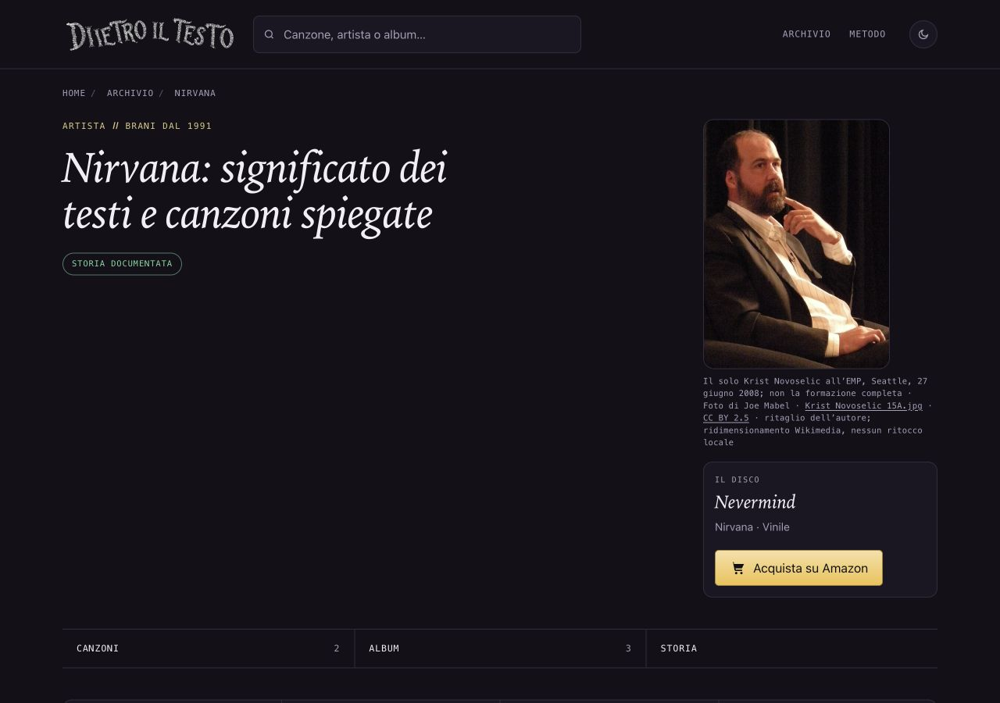

# Nirvana — ritratto del solo Krist Novoselic, 14 ottobre 2026

## Osservazione e scelta

La pagina artista non ha una fotografia. Il rapporto dell’altra AI è stato letto come pista e le fonti riaperte autonomamente. Scelta la fotografia di Joe Mabel del 2008: il volto è più leggibile alla dimensione della pagina rispetto alla foto di David Lee del 2011, anch’essa ricontrollata sul Flickr originale. Non si conclude che non esistano altre immagini libere della band: la ricerca riguarda le fonti esaminate.

Soggetto osservato nell’originale e nel file adottato: il solo Krist Novoselic, con barba, giacca scura e camicia a righe, seduto con una mano vicino al viso. Non sono raffigurati Cobain, Grohl o la formazione completa. Fotografia successiva al periodo di attività dei Nirvana, con morbidezza e grana originali. Questo limite è dichiarato nel credito.

## Provenienza e licenza

Autore e titolare: Joe Mabel, account Jmabel. Titolo originale: Krist Novoselic 15A.jpg. [Pagina originale pubblicata dal fotografo](https://commons.wikimedia.org/wiki/File:Krist_Novoselic_15A.jpg) riaperta il 14 ottobre 2026: foto propria, dichiarazione del titolare e concessione esplicita CC BY 2.5. Scatto della serie Oral History Live all’Experience Music Project (EMP), Seattle, 27 giugno 2008; caricamento il 28 giugno. Il file 15A è già un ritaglio dell’autore; non si afferma che sia privo di elaborazioni alla fonte.

Scelta [CC BY 2.5 Generic](https://creativecommons.org/licenses/by/2.5/) fra le licenze offerte, come esplicitamente consentito dalla fonte. Licenza riaperta: commerciale e adattamenti consentiti con attribuzione, titolo, fonte, collegamento alla licenza e modifiche indicate; nessuna implicazione di sostegno o restrizione aggiuntiva. Nessun obbligo ShareAlike nella licenza scelta. Non si adotta la distinta opzione GFDL.

[Originale](https://upload.wikimedia.org/wikipedia/commons/7/7d/Krist_Novoselic_15A.jpg): JPEG 1286×1726, 771976 byte, SHA256 9127be782e9c2048573d93c25b13fc64b3a2c3298238391b9c4b3cdbfbdc54e1. [Asset proporzionale Wikimedia](https://thumb.wikimedia.org/wikipedia/commons/thumb/7/7d/Krist_Novoselic_15A.jpg/500px-Krist_Novoselic_15A.jpg): JPEG 500×671, 79624 byte, SHA256 614a68ce60fdc6ed9692949b6e74762c2cd0af37681b0ee34e3aaed5870dd21f. Originale e asset scaricati due volte identici e controllati visivamente. Nessun nuovo ritaglio, ritocco o conversione locale. Resa CSS senza ingrandimento.

## Uso e accessibilità

Pagina: /artista/nirvana/. Asset: ritratti/nirvana-krist-novoselic-2008.jpg. Stesso JPEG nella figura, in og:image e twitter:image. La pagina artista condivide il link e non contiene il generatore Instagram/Storia delle canzoni. Cache e ritagli delle piattaforme restano esterni.

Credito visibile: Il solo Krist Novoselic all’EMP, Seattle, 27 giugno 2008; non la formazione completa · Foto di Joe Mabel · Krist Novoselic 15A.jpg · CC BY 2.5 · ritaglio dell’autore; ridimensionamento Wikimedia, nessun ritocco locale.

Alt: Il solo Krist Novoselic nel 2008, con barba, giacca scura e camicia chiara a righe, seduto con una mano vicino al viso; fotografia a colori.

## File, date e verifiche

Nuovo asset, sola nuova chiave nirvana in dati/ritratti.json, unico HTML artista/nirvana/index.html, sola voce sitemap-artisti.xml, questo dossier, prove e ROADMAP §114. Un solo dateModified/lastmod: 11 → 14 ottobre 2026. datePublished, titolo, description, H1, canonical, editoriale, fonti e CTA preservati. Solo griglia mobile già presente nel template corrente applicata alla singola pagina. Altri 697 HTML tracciati, cinque sitemap e 59 ritratti precedenti intatti; generatori, dati computati, ricerca, Amazon e cartoline invariati.

F40 e protezioni delle date lette prima della generazione mirata. Nessun build generale. Renderer temporaneo rimosso. SEO 696 pagine, coerenza e link 321 canzoni/104 artisti, 1065 affiliazioni, crediti/asset/alt/dimensioni/casi negativi e confronto dell’ambito: positivi. Browser 1280×900, 390×844, 320×568 scuro e 320 chiaro: nessun overflow orizzontale o ingrandimento, credito leggibile. Foto circa 239×320 desktop e 246×330 mobile. Screenshot desktop, mobile e pagina completa 320 visionati. Licenza aperta da tastiera e ritorno verificati. Zero errori locali registrati. Non una verifica integrale della biografia.

## Copia, preservazione e autorizzazioni

Copia riusata: /Users/gianmicheletroisi/.codex/worktrees/ritratto-rino-gaetano-2026-10-14/dietro-il-testo. Ramo codex/ritratto-nirvana-2026-10-14, base 132ab77dc5833fb1f66449dfe05c130734c248eb. Bocelli già pubblicato e verificato; prove locali 25b461089b355186014bb01d73d3067683b526f1 conservate su codex/bocelli-prove-pubblicazione-2026-10-14. Main e file non tracciati, copia dell’altra AI e proposte Finley/De André/prototipo preservati. 308 cartoline ferme. Inventario copie nelle prove; timeout e voce remota assente lasciati intatti.

La revisione automatica aveva bloccato la preparazione perché considerava il mandato limitato alla ricerca. Il proprietario ha poi autorizzato esplicitamente: «Approvo la preparazione isolata del lotto Nirvana». Documentazione e commit locale seguono i controlli. Integrazione nel main, push e pubblicazione restano da approvare separatamente. In futura integrazione unire soltanto la chiave nirvana e §114, preservando le altre voci/sezioni. Nessun GSC, indicizzazione o nuovo Amazon.
