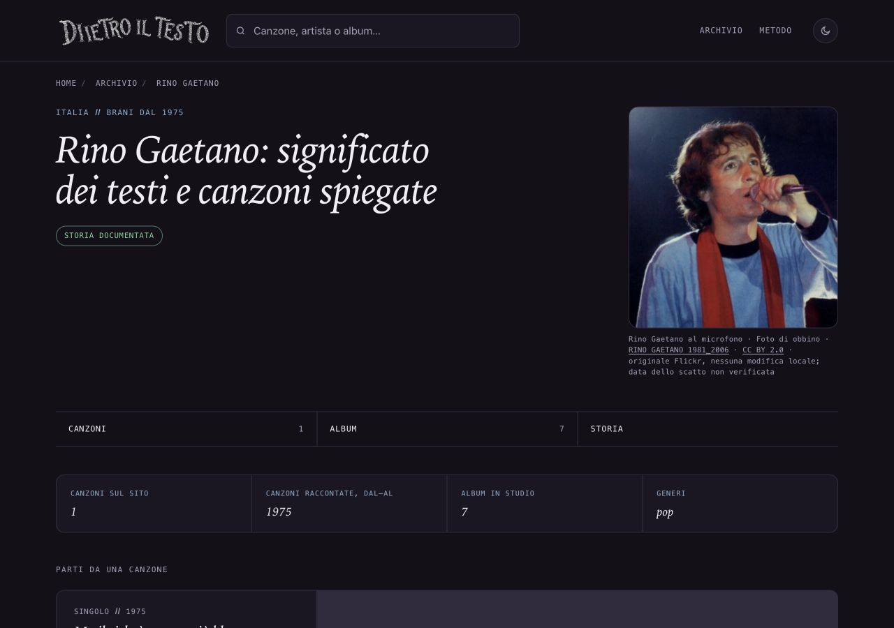

# Rino Gaetano — foto al microfono, 14 ottobre2026

## Osservazioni e immagine

Manca una fotografia sulla pagina artista. Unica ricerca del ciclo dedicata a Rino, esclusi soggetti/record dei lotti in revisione. Foto vista sulla pagina Flickr e nel JPEG originale scaricato: capelli mossi, sciarpa rossa, maglia chiara, microfono. Il file non viene ritagliato, ritoccato, ingrandito o ricostruito.

## Fonte, licenza e provenienza

Titolo originale: RINO GAETANO 1981_2006. Autore attribuito e account licenziante: obbino, come indicato dal [Flickr originale](https://www.flickr.com/photos/therebel68/221761998/) e dalla [pagina tutte le dimensioni](https://www.flickr.com/photos/therebel68/221761998/sizes/o/), entrambe riaperte14ottobre2026. La pagina indica CC BY2.0, collegamento effettivo alla licenza e disponibilità di tutte le dimensioni per il download perché è attiva la Creative Commons. Identità civile e distinta titolarità non dichiarate. Commons riaperta come riscontro: autore obbino e revisione della licenza FrancoGG30marzo2007. Prova determinante sulla pagina primaria attuale, senza presumere la permanenza di un vecchio badge.

[CC BY2.0 Generic](https://creativecommons.org/licenses/by/2.0/) riaperta: riuso commerciale e adattamenti consentiti; attribuzione, titolo se fornito, link fonte/licenza, indicazione modifiche, nessuna restrizione aggiuntiva o implicazione di sostegno. Nessun NC/editorial-only/fair use. La descrizione Flickr contiene versi: non copiata nei documenti o nel sito; prova limitata ai campi di provenienza/licenza e screenshot della pagina dimensioni.

[File originale Flickr](https://live.staticflickr.com/90/221761998_5259aea0ae_o.jpg):330×350,28531byte, SHA25643d10cd9832b8acc15b4ac978ccce1df3e639757e6a1c3c328b3079d5f49a4a9. Due download identici, formato JPEG verificato. La versione Commons624×662 aggiunta nel2012 non è usata: il file primario disponibile è330×350. Data dello scatto sconosciuta; titolo1981_2006, caricamento22agosto2006 e data digitale2006 non diventano una data fotografica. Commons riporta anche maggio1981 in una didascalia ma data sconosciuta nel riepilogo: si mantiene il limite esplicito.

## Uso, credito e alt

Pagina /artista/rino-gaetano/, asset ritratti/rino-gaetano-microfono.jpg. Stesso file nella figura e OG/Twitter. Le pagine artista condividono il link, senza formato Storia delle canzoni. Ritagli/cache delle piattaforme non controllabili, risoluzione originale limitata.

Credito visibile: Rino Gaetano al microfono · Foto di obbino · RINO GAETANO 1981_2006 · CC BY2.0 · originale Flickr, nessuna modifica locale; data dello scatto non verificata. Titolo e licenza collegati alle rispettive pagine.

Alt: Rino Gaetano con capelli mossi e una sciarpa rossa, mentre canta in un microfono tenuto nella mano sinistra; fotografia a colori su fondo scuro.

## File e date

Nuovo JPEG, sola chiave rino-gaetano in dati/ritratti.json, unico HTMLartista/rino-gaetano/index.html, unica voce sitemap-artisti.xml, prove/dossier e Roadmap§112. Lastmod/dateModified17settembre→14ottobre2026; datePublished ove presente, title/H1/description/canonical, editoriali, CTA preservati. Solo griglia mobile del template corrente applicata alla singola pagina. Altre697HTML, cinque sitemap e57ritratti precedenti identici; generatori/computati/ricerca/cartoline preservati.

## Verifiche

F40/protezioni rilette prima: generazione mirata con script temporaneo rimosso, nessun build generale. Confronto strutturale della pagina con la base: soli figura/OG/Twitter/data/griglia; SEO696, coerenza321canzoni/104artisti, affiliazioni1065, crediti/hash/alt/dimensioni/casi negativi positivi. Browser1280×900/390×844/320×568scuro e320chiaro, foto300×318desktop e280×297mobile, no ingrandimento/overflow. Screenshot desktop, mobile e didascalia320 visionati. Licenza da tastiera e ritorno corretti. Nessun errore del sito locale; sul sito esterno CC è stato registrato un errore JavaScript classList non correlato alla pagina proposta, conservato distintamente nelle prove. Nessuna attestazione di verifica integrale della biografia.

## Copia, integrazione e autorizzazioni

Copia /Users/gianmicheletroisi/.codex/worktrees/ritratto-rino-gaetano-2026-10-14/dietro-il-testo, ramo codex/ritratto-rino-gaetano-2026-10-14, base5ea40016d6e33e73a75477d58b61b225d7614f03. Creazione riuscita; registrazione/riaggancioapp falliti per limite100allegati, unico checkout.30copie controllate,12timeout e voce remota assente preservati. Main/nontracciati, altraAI/rapporti16–46 e tutte le proposte intatti; nessun rapporto nuovo. Wonderwallf7ade2bae nella distinta copia Mina lasciato intatto durante la preparazione fotografica, poi approvato dal proprietario. Prototipo6f5d86e4b e308cartoline fermi.

Integrare soltanto nuova chiave rino-gaetano e§112; la§111 è riservata a Wonderwall sull'altro ramo. Non sostituire l'intero JSON o Roadmap. Un commit locale solo dopo verifica; main/push/pubblicazione di Rino richiedono approvazione specifica. Nessun GSC/IndexNow o nuovoAmazon. Limiti: originale piccolo e leggermente morbido, data dello scatto non verificata.
