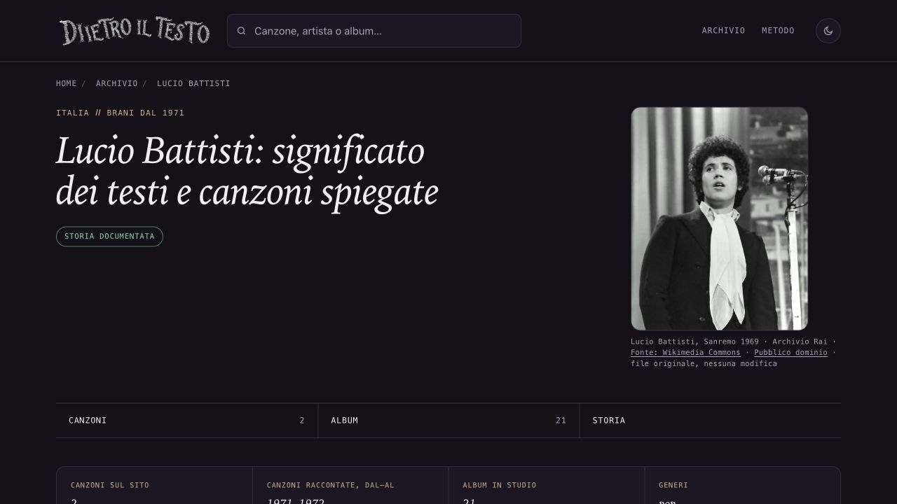

# Battisti — pubblicazione verificata, 15 ottobre 2026

Il proprietario ha approvato esplicitamente integrazione, push e pubblicazione di ee6da2d85. Main avanzato linearmente da 600ffc4bb a ee6da2d8570c3440484055d824d06c9c5c14cd7e e inviato a origin/main. Nessun altro lotto incluso, due file non tracciati preservati.

Vercel: team giantroisi1, progetto dietro-il-testo, produzione Ready / Current / Latest, deployment 2X2Zno92A6a8mLXGWbt2dBeHbSio, 15 ottobre 2026 11:13:36 CEST, durata 15 secondi. Dominio www.dietroiltesto.it assegnato. URL deployment https://dietro-il-testo-k9jw19ey4-giantroisi1.vercel.app/ . Commit del rilascio esatto ee6da2d85.

Controllo HTTPS sul dominio pubblico: HTML Battisti, JPEG e tutte e sei le sitemap identici byte per byte al commit approvato. Browser pubblico: foto caricata 472×597, visualizzata 253×320 senza ingrandimento, credito presente, nessun overflow. Immagine della pagina, og:image e twitter:image identiche. Zero errori/warning con origine sul sito; i messaggi del pannello Vercel precedente sono separati e non attribuiti al sito statico. Screenshot online osservato.

Ora il registro contiene 104 fotografie per 104 pagine artista. Nessun artista privo di foto; i limiti delle immagini parziali e storiche già dichiarati nei singoli dossier restano validi. Sola pagina Battisti e suo lastmod modificati; altre pagine/editoriale/datePublished/ritratti precedenti preservati. Nessun build generale, nuovo Amazon, GSC o cartolina.

Queste prove e l’appendice ROADMAP sono un commit locale distinto, senza nuovo rilascio. Il commit pubblicato rimane ee6da2d85. Routine fotografica già disattivata, non riattivata.

