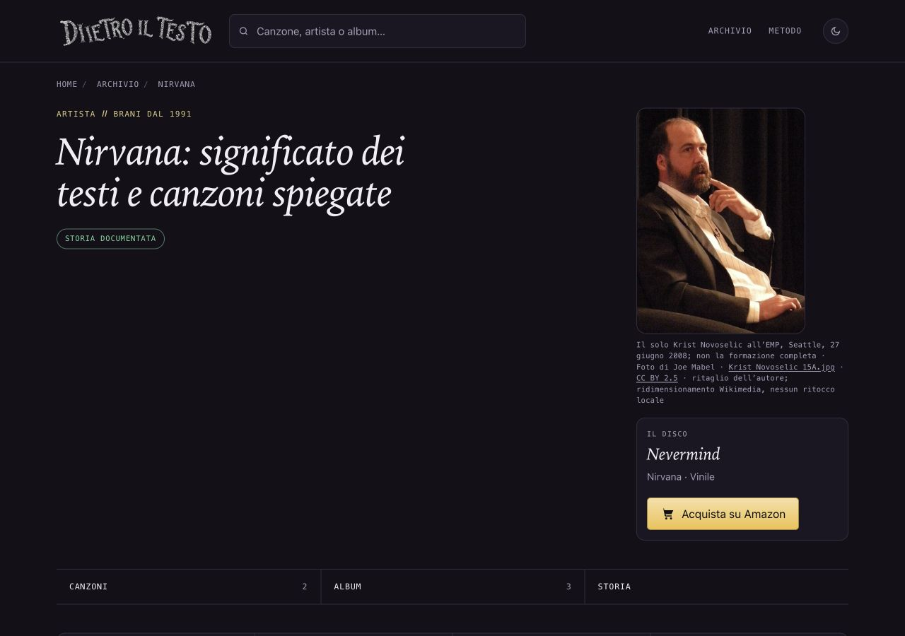

# Nirvana — pubblicazione verificata, 14 ottobre 2026

Il proprietario ha autorizzato esplicitamente «Approvo Nirvana: integrazione, push e pubblicazione». Lotto 6f675aa65de55bba1e25d0f583bf53c7fe0bf4ee integrato nel main con avanzamento lineare dalla base132ab77dc e inviato a origin/main; nessun altro lotto incluso. Main e remoto concordano sul commit. I due file non tracciati sono preservati. Copia dell’altra AI e proposte separate intatte; 308 cartoline ferme.

## Risultato Vercel

- Progetto dietro-il-testo, team giantroisi1, ambiente Production.
- Deployment 9ouTKpTiw1HfdM1J6ViT6fd6LuKa, stato READY.
- Commit 6f675aa65, durata31secondi, completamento14ottobre2026 alle20:27:39CEST.
- URL https://dietro-il-testo-dxsou4bx1-giantroisi1.vercel.app e pagina pubblica https://www.dietroiltesto.it/artista/nirvana/.
- Sito statico, nessun build generale locale o rigenerazione delle date.

Il connettore Vercel restituisce403 per lo scopegiantroisi1; CLI assente. Esito verificato nel pannello con la sessione già autenticata dal proprietario, senza modificare impostazioni, permessi o altri progetti. Il limite del connettore permane; non sono stati letti log runtime tramite CLI. Nessun errore console nella pagina pubblica.

## Verifiche online

Pagina HTML, JPEG e sei sitemap effettive identici byte per byte ai file approvati, con HTTPS e verifica certificati attiva. Fotografia500×671 e SHA256614a68ce60fdc6ed9692949b6e74762c2cd0af37681b0ee34e3aaed5870dd21f. Figura, og:image e twitter:image indicano esattamente lo stesso JPEG. Credito e limite del solo Krist Novoselic2008 visibili, CC BY2.5 e fonte collegati. Lastmod/dateModified del solo artista11→14ottobre già verificati; altre pagine/date intatte.

Browser1280×900,390×844 e320×568: file caricato, nessun overflow o ingrandimento, zero errori/warning. Screenshot desktop/mobile ispezionati. Questa pubblicazione non attesta una nuova verifica integrale della biografia.

Prove salvate in rapporti/prove-pubblicazione-nirvana-2026-10-14. Questa documentazione è un commit locale su codex/nirvana-prove-pubblicazione-2026-10-14; non inviata a main per evitare una seconda pubblicazione solo documentale. Nessuna autorizzazione ulteriore necessaria per il lotto fotografico ora online. Fonte/licenza nel dossier originale, rapporti/licenze/ritratto-nirvana-2026-10-14.md.
