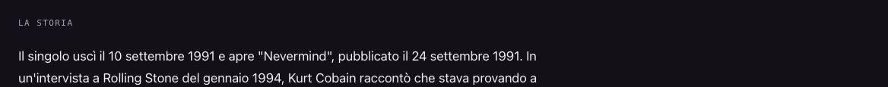

# Smells Like Teen Spirit — date distinte, 13 ottobre 2026

## Osservazione e prove

Il rapporto 41 dell'altra AI segnala un problema nell'incipit. Riaperto il sito pubblico via HTTPS, l'errore è ancora presente nel corpo e nella description: «Brano d'apertura e primo singolo di Nevermind, uscito il 10 settembre 1991». La formulazione attribuisce all'album la data del singolo. La copia della pagina online prima dell'intervento è nelle prove.

Fonti riaperte il 13 ottobre 2026:

- [Nirvana, cronologia ufficiale](https://www.nirvana.com/timelines/): Nevermind pubblicato il 24 settembre 1991.
- [HISTORY.com Editors](https://www.history.com/this-day-in-history/september-10/nirvanas-smells-like-teen-spirit-is-released-as-a-single), aggiornamento 27 maggio 2025: singolo pubblicato il 10 settembre 1991.
- [Nirvana, tracklist ufficiale](https://www.nirvana.com/releases-archive/nevermind/): Smells Like Teen Spirit apre l'album.
- [Apple Music, canzone](https://music.apple.com/us/song/smells-like-teen-spirit/1586895442): riscontro indipendente del 10 settembre 1991; non aggiunto alla lista perché le tre fonti precedenti bastano all'intervento.

## Correzione preparata

«Il singolo uscì il 10 settembre 1991 e apre “Nevermind”, pubblicato il 24 settembre 1991.»

Una frase modificata in corpo, description, Open Graph, JSON-LD e testo condivisibile; tre fonti aggiunte e visibili. Tutte le fonti precedenti conservate. Nel JSON cambia un solo record, teen-spirit, e soltanto corpo[0] e fonti.

La stessa vecchia frase era memorizzata in otto anteprime derivate: aggiornata lì con una sostituzione esatta, senza rigenerare le pagine né cambiarne altri contenuti.

## File toccati

- dati/canzoni.json
- canzone/teen-spirit/index.html
- album/nirvana/nevermind/index.html
- anni/1990/index.html
- archivio/index.html
- artista/nirvana/index.html
- canzone/come-as-you-are/index.html
- canzone/nightswimming/index.html
- canzone/under-the-bridge/index.html
- genere/rock/index.html
- sitemap-canzoni.xml
- ROADMAP.md, questo dossier e prove dedicate.

## Date e verifiche

dateModified e lastmod cambiano soltanto per /canzone/teen-spirit/: 11 → 13 ottobre 2026. Le altre otto pagine mantengono le date perché cambia solo l'anteprima di un'altra scheda, secondo F40. datePublished invariata (1991). Altri 687 HTML e cinque sitemap identici alla base; fonti, CSS, CTA, immagini, renderer, ricerca, affiliazioni e altri record preservati. Nessun build generale.

SEO: 696 pagine, zero problemi. Link/coerenza: 321 canzoni e 104 artisti, zero problemi. Affiliazioni: 1065 link, zero problemi. Diff controllato. Diciannove prove browser: scheda a 1280/390/320 e otto estratti a 1280/320; frase corretta, fonti visibili, nessun overflow o errore console. Confronto rigoroso limita le differenze ai blocchi dichiarati.

## Copia, limiti e autorizzazioni

Copia: /Users/gianmicheletroisi/.codex/worktrees/ritratto-883-2026-10-13/dietro-il-testo. Ramo: codex/teen-spirit-date-2026-10-13. Base: 4b7933706ac51b8b8a2f4ba45a1557ba656b14ab. Ramo fotografico 883 preservato.

Precedenza circoscritta P1/P2 a un errore già online. Gli altri rilievi del rapporto 41 non sono verificati o corretti in questo lotto: nessuna verifica integrale, nessun bollino e nessun aggiornamento di ultimaVerifica. La copia dell'altra AI resta intatta.

Ricerca fotografica Nirvana soltanto preliminare: non è un lotto fotografico completato e nessun asset è stato acquisito. Proposta Eagles già presente lasciata intatta. Il prototipo curato What's My Age Again? 6f5d86e4b resta in revisione indipendente; le altre 308 cartoline restano ferme.

Main e documenti non tracciati preservati. Nessun GSC/IndexNow. Nessuna integrazione, push o pubblicazione: occorre approvazione specifica del proprietario. Integrare solo questo record e i suoi estratti, senza sovrascrivere cartoline o altri lotti; aggiungere questa sezione Roadmap senza sostituire sezioni di proposte distinte.
