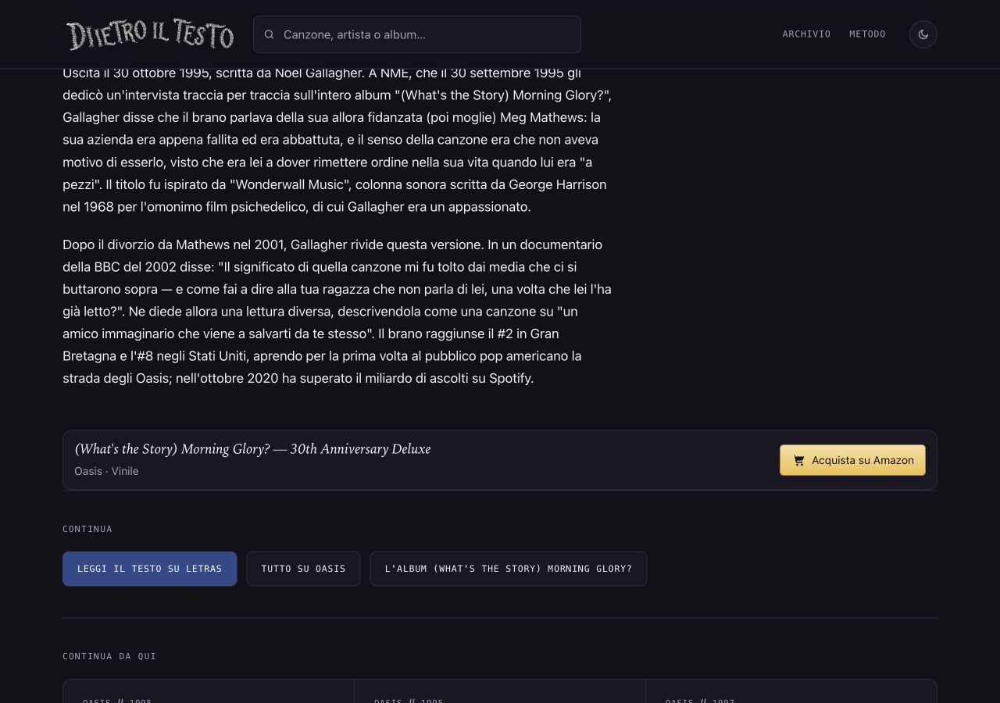

# Wonderwall — miliardo di ascolti, 14 ottobre 2026

## Osservazione e precedenza

Il rapporto indipendente 46 è una segnalazione, non una prova. Controllato il sito pubblico via HTTPS il14ottobre: il corpo della scheda afferma che il miliardo di ascolti Spotify fu superato nel2025. Errore sostanziale di cronologia già online, P1/P2: precedenza rispetto alla ricerca fotografica. Ricerca del ciclo dedicata al solo Lucio Battisti: nessun asset adottato, grafica preservata; BattistiLucio.jpg dichiara solo il caricatore e non documenta data/provenienza originarie per verificare il pubblico dominio. Coverband Leandro Ghetti esclusa: soggetto diverso; copertine/statue non usate come ritratto. Nessun lotto fotografico dichiarato completato.

## Fonte riaperta e correzione

[Sony Music Japan, pagina ufficiale Oasis, 15 ottobre2020](https://www.sonymusic.co.jp/artist/Oasis/info/522989), riaperta14ottobre2026: il titolo e il paragrafo sul venticinquesimo anniversario dichiarano superato il miliardo Spotify prima del30ottobre2020. Si scrive soltanto «nell'ottobre2020», senza inventare il giorno preciso del superamento. Riscontro primario nel [comunicato Longevity del14ottobre2020](https://www.longevitypr.com/news-1/2020/10/14/oasis-classic-single-wonderwall-passes-one-billion-spotify-streams-as-25th-anniversary-edition-of-whats-the-story-morning-glory-charts-at-no3). Fonte Sony nominata nella sezione Sugli ascolti; copia originale .txt nelle prove.

## File toccati e date

Unica voce wonderwall in dati/canzoni.json: modifica esatta di corpo[1] e aggiunta della fonte Sony. Unica canzone/wonderwall/index.html: stesso passaggio e fonte visibile; unico sitemap-canzoni.xml: lastmod Wonderwall11→14ottobre2026, identico dateModified. DatePublished1995 invariata. Metadati/title/H1/description/canonical, CSS, momento iconico, immagini, link affiliati e altre fonti preservati. Nessun dato dinamico Spotify/GSC inventato; ascolti numerici preesistenti non riverificati e non modificati. Nessun nuovo bollino/ultimaVerifica, nessuna attestazione di verifica integrale della scheda. Altri rilievi del rapporto46 fuori dall'intervento circoscritto.

## Verifiche

F40/protezioni rilette; sostituzione mirata, nessun build generale. Confronto strutturale: un record e soli due campi, un HTML su698tracciati modificato e697identici, cinque sitemap identici e unica voce modificata nel sesto. SEO696, coerenza321canzoni/104artisti, affiliazioni1065: zero problemi. Diff pulito esclusa la sola copia immutabile della fonte Sony .txt. Browser1280×900/390×844/320×568: passaggio corretto, fonte visibile e leggibile, zero overflow/errori; tre screenshot visionati. Sito statico, nessuna API/credenziale/configurazione esterna modificata.

## Copia e autorizzazione

Riusata la copia pulita /Users/gianmicheletroisi/.codex/worktrees/ritratto-mina-2026-10-14/dietro-il-testo su nuovo ramo codex/wonderwall-miliardo-2026-10-14 dalla base main5ea40016d6e33e73a75477d58b61b225d7614f03. Prove Mina b28c58184 e ramo originale preservati. Main/nontracciati e altraAI intatti;30copie controllate,12timeout e voce remota assente lasciati intatti. Finley, DeAndré, prototipo What’s My Age Again? e altre proposte non sovrapposti;308cartoline ferme.

Unire soltanto la modifica Wonderwall e la fonte Sony nel JSON, l'unica pagina/sitemap e Roadmap§111; non sovrascrivere altri record o sezioni. Un solo commit locale dopo verifica; integrazione nel main, push e pubblicazione richiedono l'approvazione specifica della routine. Nessun push/deploy/GSC/IndexNow eseguito. Alla ripresa ordinaria tornare alle immagini.

## Pubblicazione approvata e verificata — 14 ottobre2026

Il proprietario ha approvato nominativamente Wonderwallf7ade2bae: integrazione, push e pubblicazione. Main integrato fast-forward e inviato esclusivamente f7ade2bae4241ea8ba7c28b5bb162dd5a686ca1c, senza altri lotti. Vercel dpl_FfafZjSCvn134KHtAy2pM2JHHw2s READY, progetto dietro-il-testo/teamgiantroisi1, production/main e SHAesatto; alias www.dietroiltesto.it attivo, aliasErrornull.

Pagina https://www.dietroiltesto.it/canzone/wonderwall/ e sei sitemap HTTPS con TLS attivo confrontati: byte identici al lotto approvato. Browser pubblico1280×900/390×844/320×568: ottobre2020 presente, vecchio2025 assente, fonteSony visibile e lastmod/dateModified14ottobre; screenshotdesktop/mobile/fonte320 visionati, zero overflow/errori. DatePublished1995 e altre date preservate; nessun build generale/GSC/IndexNow.

Prove in rapporti/prove-wonderwall-miliardo-2026-10-14/pubblicazione/. Main conserva solo i due SEO nontracciati con hash invariati. Rino8e07d7ed7 e altre proposte intatte in copie/rami separati,308cartoline ferme. Documentazione successiva salvata sul ramo locale codex/wonderwall-prove-pubblicazione-2026-10-14, senza secondo push. Restano i limiti editoriali della correzione circoscritta, non verifica integrale.
